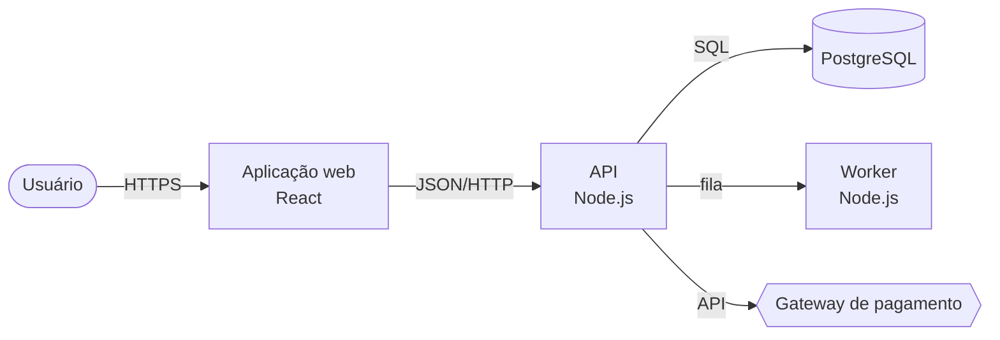

# Arquitetura (fase 4)

Responde: **como as partes se encaixam?** Um diagrama simples e fiel vale mais que quatro níveis completos e desatualizados.

## Níveis do C4 (referência, sem exagero)

| Nível | Mostra | Quando fazer |
|---|---|---|
| **Contexto** | o sistema como uma caixa, as pessoas que o usam e os sistemas externos com que conversa | sempre |
| **Contêiner** | o que precisa estar rodando: aplicação web, API, worker, banco, fila, armazenamento, com a tecnologia de cada um e como se falam | sempre que houver mais de um processo ou um banco |
| Componente | as partes internas de **um** contêiner (módulos, camadas) | só no contêiner onde o trabalho costuma cair, e se ajudar o público |
| Código | classes e funções | não fazer: o código já mostra |

Contêiner vem da **realidade do deploy** (`Dockerfile`, `docker-compose`, manifestos, CI, `Procfile`, configuração da nuvem), não do agrupamento de pastas.

## Pedido ao `leitor-codigo`

Somente leitura, `arquivo:linha` em tudo, a partir de `inventario.md`, `levantamento.md` e `execucao.md`:

1. **Contêineres:** cada processo ou serviço que sobe, com tecnologia e onde é definido; bancos, filas, caches, armazenamento.
2. **Comunicação:** quem chama quem e como (HTTP, fila, banco compartilhado, arquivo), com o ponto do código que faz a chamada ou a configuração que liga as partes.
3. **Sistemas externos:** cada integração (pagamento, e-mail, autenticação, APIs), o cliente usado e onde é configurada.
4. **Camadas e módulos:** como o código se organiza por dentro (rotas → serviços → repositórios, ou outro), com um exemplo de ponta a ponta.
5. **Dados:** onde ficam os modelos, migrações, quem escreve e quem só lê cada tabela principal.
6. **Autenticação e autorização:** onde o usuário é identificado, onde as permissões são checadas.

## Diagrama

Mermaid dentro do Markdown. `flowchart` renderiza em qualquer visualizador; a sintaxe `C4Context`/`C4Container` do Mermaid é experimental (Premissa: conferir na versão em uso antes de adotá-la).



- Cada caixa e cada seta tem evidência em `arquitetura.md` (tabela abaixo). Seta sem evidência sai ou fica tracejada (`-.->`) com legenda "não verificado".
- Até ~12 elementos por diagrama. Passou disso, separe por nível.
- Rótulos dizem o que flui ou o protocolo, não "usa".

## Conferência independente

Despache um **segundo** `leitor-codigo` com o diagrama e a tabela de evidências e a pergunta: "para cada caixa e seta, a evidência citada mostra isso? Falta alguma chamada a sistema externo ou contêiner que o código faz?". Quem montou o diagrama não confere. Divergência: corrija ou marque.

## Modelo de `arquitetura.md`

```markdown
# Arquitetura: <slug>

- **Data**: <AAAA-MM-DD> · **Commit**: <hash curto> · **Níveis**: contexto, contêiner<, componente de <contêiner>>
- **Conferido por**: segundo `leitor-codigo` em <data> — <sem divergência | N corrigidas>

## Evidências
| Elemento (caixa ou seta) | Evidência | Visto rodando? |
|---|---|---|
| API → PostgreSQL | `src/db/client.ts:8`, `docker-compose.yml:14` | sim (fase 3) |

## Decisões e porquês encontrados
- <decisão> — <commit, ADR ou pessoa>

## Não verificado
- <elemento> — <por quê>
```

## Documento

No destino (em geral `docs/arquitetura.md`): o diagrama de contexto, o de contêiner, uma tabela curta por contêiner (o que faz, tecnologia, onde está o código, como sobe), integrações externas, dados e autenticação em poucas linhas, e o caminho de ponta a ponta de uma requisição típica. Sem detalhe que o código mostra melhor.
