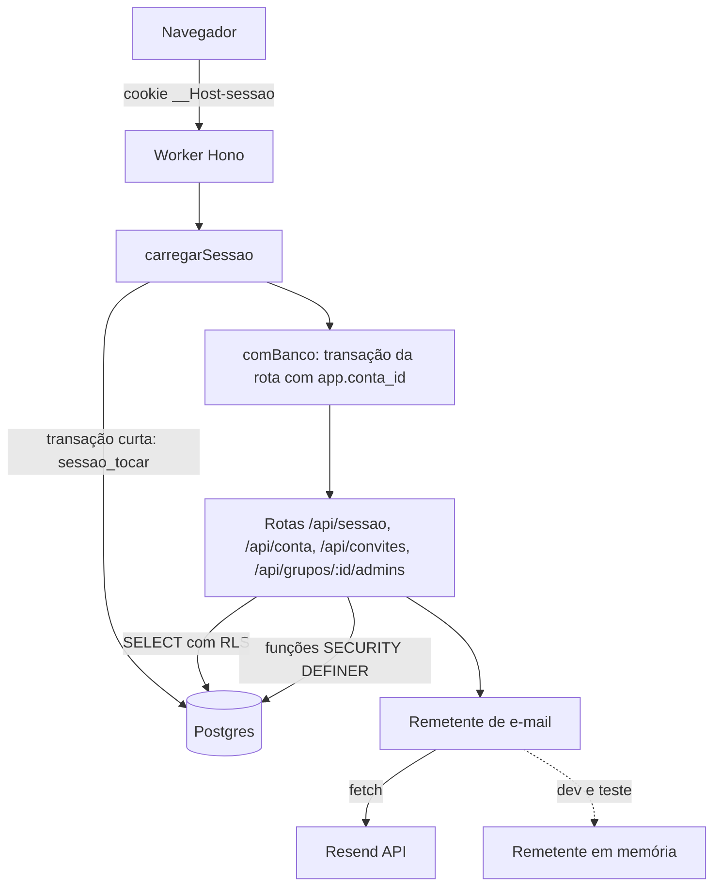

# Conta e acesso — Desenho

**Spec**: `.specs/features/conta-e-acesso/spec.md` (e `context.md`)
**Status**: Approved (usuário, 2026-10-27)
**Mockup**: aprovado em 2026-10-27, `.specs/features/conta-e-acesso/mockup/` (36 telas; galeria https://claude.ai/artifact/UqN3tUswVizPSCVAd7NfX7)
**Abordagem escolhida pelo usuário (2026-10-27)**: funções `SECURITY DEFINER` no banco para toda operação que precisa
achar uma conta sem sessão. Alternativas recusadas: role separada `pelada_auth` (um segredo e uma conexão a mais, e a
role leria qualquer conta) e contexto extra na RLS (`app.email_login`), que faria o isolamento depender da aplicação.

Conforma com AD-001 a AD-006. Decisões novas de projeto: AD-007 a AD-010 (fim deste documento).

---

## Architecture Overview

O Worker continua com uma transação por requisição (ADR-025). O que muda:

1. **Resolução da sessão em transação própria.** Antes do `comBanco`, o middleware `carregarSessao` lê o cookie, calcula
   o SHA-256 do token e chama `sessao_tocar(hash)` numa transação curta de leitura e escrita. A função confere as
   12 h absolutas e os 15 min de inatividade, renova `ultimo_uso_em` e devolve o `conta_id`. O middleware fixa
   `c.set('contaId', …)`, e só então o `comBanco` abre a transação da rota, já com `app.conta_id` correto e mantendo
   o `READ ONLY` nas leituras (FUN-16). Isso fecha a pendência do ADR-025 ("a busca da sessão acontece antes de existir
   conta").
2. **Funções do banco para o que não tem sessão.** Cadastro, entrar, links (confirmação, recuperação) e convites passam
   por funções `SECURITY DEFINER` com `search_path` fixo. Elas recebem só hashes e valores já validados e devolvem o
   mínimo. O `pelada_app` só tem `EXECUTE` nelas e nunca lê a linha de outra conta nem um hash de senha.
3. **RLS nas tabelas de conta.** `contas` e `sessoes` ficam visíveis só para a própria conta (`app_conta_id()`). As
   tabelas de apoio (`tentativas_login`, `links_conta`, `envios_email`, `pedidos_reset`) ficam com RLS `FORCE` e sem
   grant para o `pelada_app`: só as funções as tocam.
4. **Tokens fora da URL do servidor.** Os links de e-mail levam o token no fragmento (`/confirmar#t=…`). O front lê o
   fragmento e o envia no corpo de um POST, então ele nunca aparece em log de acesso nem no `Referer`.



---

## Code Reuse Analysis

### Existing Components to Leverage

| Component | Location | How to Use |
| --- | --- | --- |
| Transação da requisição | `backend/api/src/infraestrutura/db/transacao-da-requisicao.ts:84` | Reaproveitada como está. A sessão abre uma segunda transação curta com a mesma função (`somenteLeitura: false`, contexto vazio) |
| `comBanco`, `exigirCabecalhoPelada`, limitadores | `backend/api/src/entrada/middlewares/` | Hoje os limitadores vêm antes do CSRF (`app.ts:40-48`, SEC-005 em aberto); C3 inverte a ordem e o ACE-49 ganha o teste. O limitador `LIMITE_ENTRAR` passa a cobrir também as outras rotas sem sessão (ACE-50) |
| Erro padrão | `backend/api/src/entrada/erros.ts:12-39` | Novos códigos (`credenciais_invalidas`, `email_nao_confirmado`, `bloqueado_temporariamente`, `sessao_expirada`, `link_invalido`, `termos_obrigatorios`, `senha_atual_incorreta`, `unico_admin`, `ultimo_admin`, `ja_e_admin`, `convite_de_outro_email`, `email_indisponivel`, `dados_invalidos`) |
| `LIMITES` | `backend/contrato/src/limites.ts:2-30` | Senha, e-mail e nome já estão lá; os schemas zod usam esses números |
| Cliente de teste e apoio de banco | `backend/api/test/apoio/cliente.ts:27`, `banco.ts`, `como-role.ts`, `cenario-dois-grupos.ts` | Testes de rota e de isolamento; o cenário ganha duas contas com senha |
| Suíte de isolamento | `backend/api/test/isolamento/` | Novos casos (`links_conta`, `convites_admin`, `envios_email`, `contas`, `sessoes`) e a listagem de rotas do Hono (G-04) |
| Cookie do legado | legado `backend/api/src/infraestrutura/sessao/cookie.ts` | Copiado: `__Host-sessao`, atributos do G-09; a duração passa a seguir a D7 |
| Middlewares de sessão do legado | legado `backend/api/src/entrada/middlewares/sessao.ts` | Copiados e adaptados: `carregarSessao` passa a usar `sessao_tocar`; `exigirSessaoCompleta` some (não há escopo de troca de senha) |
| Schemas do contrato do legado | legado `backend/contrato/src/sessao.ts`, `primitivos.ts` | Copiados com zod; acrescentam cadastro, links e convites |
| `dono.ts` do legado | legado `backend/scripts/dono.ts` | Copiado e adaptado à trava de host do app novo e à função `conta_definir_senha` |
| Cliente HTTP, sessão e guarda do legado | legado `frontend/web/src/dados/cliente.ts`, `dados/sessao.ts`, `app/guarda/` | Copiados; `decidirRota` ganha os destinos novos. Usa TanStack Query, como o legado |
| Telas do legado | legado `frontend/web/src/telas/{entrar,esqueci,minha-senha,privacidade,admins}` | Copiadas com os textos novos; `NovaSenha` passa a usar o token do link; `FormularioAdicionarAdmin` vira convite |
| Componentes base | `frontend/web/src/componentes/` | `CampoSenha`, `CamposNovaSenha`, `Campo`, `CaixaSelecao`, `Botao`, `TelaMensagem`, `ResumoErros`, `Dialogo`, `Lista` |
| Comparação visual | `frontend/web/e2e/visual.mjs`, `e2e/telas-ativas.txt`, `.specs/mockup/telas.json` | As telas de acesso entram em `telas-ativas.txt` |

### Integration Points

| System | Integration Method |
| --- | --- |
| Postgres | Uma migration nova `…_conta-e-acesso.sql` (aditiva): colunas em `contas` e `tentativas_login`, tabelas `links_conta`, `convites_admin`, `envios_email`, funções, policies e grants |
| Resend | `fetch` para `https://api.resend.com/emails` com `Authorization: Bearer RESEND_API_KEY` e `Idempotency-Key` (pesquisa de 2026-10-26: API HTTP documentada, chave idempotente de até 256 caracteres por 24 h) |
| Front | Rotas novas em `frontend/web/src/app/rotas.tsx`; `/app` com guarda; `/` continua a página provisória |
| Comparação visual | Telas t04, t05, t06, t07, t08, t19, t25 do mockup atual e as telas novas do mockup do módulo |

---

## Components

### C1. Migration da conta e acesso

- **Purpose**: schema, RLS, grants e funções desta feature, numa migration aditiva (G-14).
- **Location**: `backend/api/src/infraestrutura/db/migracoes/<timestamp>_conta-e-acesso.sql`
- **Interfaces (SQL)**:
  - `contas`: `email_confirmado_em timestamptz`, `termos_versao text`, `termos_aceitos_em timestamptz`, `excluida_em timestamptz`. A migration faz `UPDATE contas SET email_confirmado_em = criada_em WHERE email_confirmado_em IS NULL` (contas existentes; premissa da spec).
  - `tentativas_login`: `ip_hash bytea` (SHA-256 do IP; LGPD: o IP não fica gravado) e índice `(email, ip_hash, momento)`.
  - `links_conta (id, conta_id, tipo 'confirmacao'|'recuperacao', token_hash bytea(32) único, criado_em, expira_em, usado_em)`, com índice único parcial de um pendente por conta e tipo.
  - `convites_admin (id, grupo_id, email, token_hash bytea(32) único, criado_por, criado_em, expira_em, usado_em, cancelado_em)`, com índice único parcial de um pendente por grupo e e-mail.
  - `envios_email (destino_hash bytea, tipo text, enviado_em timestamptz, PRIMARY KEY (destino_hash, tipo))`: guarda o último envio para o intervalo de 60 s (ACE-51).
  - RLS `ENABLE` + `FORCE` em `contas`, `sessoes`, `tentativas_login`, `links_conta`, `envios_email`, `pedidos_reset` e `convites_admin`, com policy `USING (true)` para `pelada_backup` em todas (G-27, G-29).
  - Policies do `pelada_app`: `contas` lê e altera `id = app_conta_id()`; `sessoes` lê e apaga `conta_id = app_conta_id()`; `convites_admin` segue o padrão de grupo (`grupo_id IN (SELECT grupos_visiveis())`, escrita com conta).
  - Grants do `pelada_app`: `SELECT, UPDATE (nome)` em `contas`; `SELECT, DELETE` em `sessoes`; `SELECT, INSERT, UPDATE` em `convites_admin`; `INSERT` em `auditoria`. Nenhum grant em `tentativas_login`, `links_conta`, `envios_email`, `pedidos_reset`. A coluna `senha_hash` fica fora do `SELECT` por grant de coluna.
  - Funções (`SECURITY DEFINER`, `SET search_path = public, pg_temp`, `EXECUTE` só para `pelada_app`; `REVOKE` de `PUBLIC`). Toda senha chega como parâmetro e o hash é `crypt($senha, gen_salt('bf', 12))`:

    | Função | Faz | Devolve |
    | --- | --- | --- |
    | `conta_cadastrar(email, nome, senha, termos_versao, token_hash)` | cria a conta não confirmada e o link de confirmação; se o e-mail existe, não altera nada | `(situacao 'nova'\|'existente', conta_id, enviar boolean)` |
    | `conta_entrar(email, senha, ip_hash, token_hash)` | trava o par e-mail e IP (`pg_advisory_xact_lock`), confere o bloqueio, compara a senha (hash fixo quando o e-mail não existe, para tempo igual), grava a tentativa e, com sucesso, cria a sessão | `(resultado 'ok'\|'invalida'\|'bloqueado'\|'nao_confirmado', conta_id, nome, bloqueado_ate)` |
    | `sessao_tocar(token_hash)` | apaga a sessão vencida; renova `ultimo_uso_em` da válida | `conta_id` ou nulo |
    | `link_pedir(email, tipo, token_hash)` | cria ou troca o link do tipo (o anterior perde a validade) e respeita o intervalo de 60 s | `(enviar boolean, nome)` |
    | `link_confirmar(token_hash, token_sessao_hash)` | consome o link de confirmação, marca o e-mail e cria a sessão | `conta_id` ou nulo |
    | `link_nova_senha(token_hash, senha)` | consome o link de recuperação, troca a senha, confirma o e-mail e apaga todas as sessões | `boolean` |
    | `conta_trocar_senha(senha_atual, senha_nova)` | usa `app_conta_id()`, confere a atual e apaga as outras sessões (recebe o hash da sessão atual para mantê-la) | `boolean` |
    | `conta_excluir(senha)` | usa `app_conta_id()`; recusa se for a única admin de grupo não arquivado; anonimiza (abaixo) | `(resultado, grupos jsonb)` |
    | `convite_criar(grupo_id, email, token_hash)` | só com vínculo da conta no grupo; recusa quem já é admin; respeita os 60 s | `(resultado, convite_id, expira_em, enviar)` |
    | `convite_ler(token_hash)` | dados mínimos do convite válido | `(email, grupo_nome, conta_existe boolean)` |
    | `convite_aceitar(token_hash)` | com `app_conta_id()`, confere o e-mail, trava o convite (`FOR UPDATE`) e cria o vínculo | `(resultado, grupo_id)` |
    | `convite_cadastrar(token_hash, nome, senha, termos_versao, token_sessao_hash)` | cria a conta já confirmada com o e-mail do convite, o vínculo e a sessão | `(resultado, conta_id, grupo_id)` |
    | `conta_definir_senha(email, senha, dono boolean)` | só para o script `dono.ts` (sem `EXECUTE` para o `pelada_app`; roda como owner) | `conta_id` |

  - **Exclusão como anonimização**: `grupos.criado_por`, `vinculos_admin.criado_por`, `auditoria.autor_conta_id` e `pedidos_reset.resolvido_por` referenciam `contas`, então apagar a linha quebraria o histórico. `conta_excluir` apaga sessões, vínculos, links e convites enviados ao e-mail. Na linha da conta, troca o e-mail por `excluida-<id>@invalido`, o nome por "Conta excluída" e o hash por `!` (nunca casa), e grava `excluida_em`. Assim, nenhum nome ou e-mail da pessoa fica no banco, e a auditoria mostra "Conta excluída" como autor (ACE-28).
- **Dependencies**: `pgcrypto` (já na linha de base), `grupos_visiveis()` e `app_conta_id()` do `…_rls.sql`.
- **Reuses**: o loop de policies do `…_rls.sql` como modelo; o `HASH_FIXO` e a trava por e-mail do legado (`tentativas.ts:58-69`), agora por e-mail e IP.

### C2. Repositórios de conta

- **Purpose**: a única porta da aplicação para as funções e tabelas de conta (G-02).
- **Location**: `backend/api/src/infraestrutura/db/repositorios/{contas,sessoes,links,convites,admins,auditoria}.ts`, e os tipos em `infraestrutura/db/tipos.ts` (declaration merging)
- **Interfaces**:
  - `contas.cadastrar(db, dados)`, `contas.entrar(db, dados)`, `contas.trocarSenha(db, dados)`, `contas.excluir(db, senha)`, `contas.eu(db)`
  - `sessoes.tocar(urlBanco, tokenHash): Promise<string | null>` (abre a transação curta), `sessoes.encerrarAtual(db, tokenHash)`
  - `links.pedir(db, email, tipo, tokenHash)`, `links.confirmar(db, …)`, `links.novaSenha(db, …)`
  - `convites.criar(db, grupoId, …)`, `convites.ler(db, tokenHash)`, `convites.aceitar(db, tokenHash)`, `convites.cadastrar(db, …)`, `convites.cancelar(db, grupoId, id)`
  - `admins.listar(db, grupoId)`, `admins.remover(db, grupoId, contaId)`: `grupoId` sempre como primeiro parâmetro de dado (G-03); a recusa do último admin é um `SELECT … FOR UPDATE` dos vínculos do grupo na mesma transação
  - `auditoria.registrar(db, grupoId, acao, entidade, resumo)`
- **Dependencies**: `Db` de `c.var.db`.
- **Reuses**: a forma dos repositórios do legado, sem o `ExecutorDb` (o app novo passa o `Db` da transação).

### C3. Middlewares de sessão e de vínculo

- **Purpose**: resolver a sessão antes da transação da rota (ACE-47) e barrar o acesso a grupo sem vínculo (ACE-41).
- **Location**: `backend/api/src/entrada/middlewares/{sessao,vinculo}.ts`, `backend/api/src/infraestrutura/sessao/{cookie,token}.ts`
- **Interfaces**:
  - `carregarSessao`: lê `__Host-sessao`; sem cookie, segue sem conta; com cookie, chama `sessoes.tocar` e fixa `contaId` e `tokenHash`; sessão inválida limpa o cookie.
  - `exigirSessao`: 401 `sessao_expirada` sem conta.
  - `exigirVinculo`: em `/api/grupos/:grupoId/*`, um `SELECT id FROM grupos WHERE id = $1` sob RLS; sem linha, 404.
  - `gerarToken(): { token, hash }` (32 bytes de `crypto.getRandomValues`, base64url; hash `crypto.subtle.digest('SHA-256')`).
  - `hashIp(ip)`: SHA-256 do `CF-Connecting-IP`.
- **Order in `criarApp`**: Sentry, `semCache`, `semSniff`, `exigirCabecalhoPelada`, limitadores, `bodyLimit`, `carregarSessao`, `comBanco`, rotas. O CSRF passa para antes dos limitadores **de fato** (hoje `app.ts:40-48` ainda tem os limitadores antes; o teste do ACE-49 prova a ordem).
- **Reuses**: o cookie do legado (`cookie.ts:4-35`).

### C4. Casos de uso e rotas

- **Purpose**: as rotas da spec, finas sobre os casos de uso.
- **Location**: `backend/api/src/aplicacao/acesso/*.ts` e `backend/api/src/entrada/rotas/{sessao,conta,convites,admins}.ts`
- **Interfaces (HTTP)**:

  | Rota | Sessão | Limite | Critérios |
  | --- | --- | --- | --- |
  | `POST /api/conta` | não | `LIMITE_ENTRAR` | ACE-01 a ACE-05 |
  | `POST /api/conta/confirmar` `{token}` | não | `LIMITE_ENTRAR` | ACE-06, ACE-07 |
  | `POST /api/conta/reenviar-confirmacao` `{email}` | não | `LIMITE_ENTRAR` | ACE-08 |
  | `POST /api/sessao/entrar` | não | `LIMITE_ENTRAR` | ACE-09 a ACE-14 |
  | `GET /api/sessao` | sim | — | ACE-18 |
  | `POST /api/sessao/sair` | sim | — | ACE-17 |
  | `POST /api/sessao/esqueci-senha` `{email}` | não | `LIMITE_ENTRAR` | ACE-22, ACE-23 |
  | `POST /api/sessao/nova-senha` `{token, senha}` | não | `LIMITE_ENTRAR` | ACE-24, ACE-25 |
  | `POST /api/conta/senha` | sim | — | ACE-26, ACE-27 |
  | `POST /api/conta/excluir` `{senha}` | sim | — | ACE-28 a ACE-30 |
  | `POST /api/convites/ler` `{token}` | não | `LIMITE_ENTRAR` | ACE-34, ACE-36 |
  | `POST /api/convites/aceitar` `{token}` | sim | — | ACE-33, ACE-35, ACE-36 |
  | `POST /api/convites/cadastrar` `{token, nome, senha, termos}` | não | `LIMITE_ENTRAR` | ACE-34 |
  | `GET /api/grupos/:grupoId/admins` | sim + vínculo | — | ACE-37, ACE-41 |
  | `POST /api/grupos/:grupoId/admins/convites` | sim + vínculo | — | ACE-31, ACE-32 |
  | `DELETE /api/grupos/:grupoId/admins/convites/:id` | sim + vínculo | — | ACE-38 |
  | `DELETE /api/grupos/:grupoId/admins/:contaId` | sim + vínculo | — | ACE-39, ACE-40 |

  Toda escrita grava a auditoria na mesma transação (ACE-42). As respostas com sessão nova enviam o `Set-Cookie`.
- **Dependencies**: C2, C3, C5, contrato (C6).
- **Reuses**: casos de uso do legado em `aplicacao/acesso/` como referência de comportamento (não de forma).

### C5. Remetente de e-mail

- **Purpose**: enviar os e-mails de conta e permitir que os testes leiam os links.
- **Location**: `backend/api/src/infraestrutura/email/{remetente,resend,memoria,modelos}.ts`
- **Interfaces**:
  - `interface Remetente { enviar(m: { para, assunto, texto, html, chave }): Promise<'enviado' | 'falhou'> }`
  - `remetenteResend(env)`: `fetch` com `Idempotency-Key = chave` (tipo + hash do token), `text` e `html`; qualquer resposta que não seja 2xx, inclusive 429 de cota diária, vira `'falhou'` e um log só com o status e o código do Resend (ACE-52, ACE-21).
  - `remetenteMemoria()`: guarda as mensagens; usado nos testes e no `wrangler dev` quando `EMAIL_DEV=1`. Nesse modo, e só nele, a rota `GET /api/dev/emails` lista as mensagens. O `wrangler.jsonc` de produção não define `EMAIL_DEV`, e um teste de configuração garante isso.
  - Modelos: confirmação, recuperação, convite e aviso de cadastro duplicado, com o link montado a partir de `URL_PUBLICA` (G-18) e o token no fragmento.
- **Dependencies**: `RESEND_API_KEY` (segredo), `RESEND_REMETENTE` (já no `.env.example`), `URL_PUBLICA`.
- **Reuses**: nada do legado (não enviava e-mail).

### C6. Contrato com zod e snapshot de compatibilidade

- **Purpose**: schemas de corpo e resposta das rotas, usados pela API e pelo web, e a proteção do G-20.
- **Location**: `backend/contrato/src/{primitivos,sessao,conta,convites,admins,termos}.ts`; `backend/contrato/scripts/checar-compatibilidade.ts` e `backend/contrato/compatibilidade.json`
- **Interfaces**: schemas `.strict()` (`cadastroCorpo`, `entrarCorpo`, `emailCorpo`, `tokenCorpo`, `novaSenhaCorpo`, `trocarSenhaCorpo`, `excluirCorpo`, `conviteCorpo`, `sessaoEu`, `adminsResposta`); `TERMOS_VERSAO`. O script gera a forma JSON de cada schema e falha se um campo for removido, renomeado ou passar a obrigatório sem estar listado em `QUEBRAS.md`.
- **Dependencies**: `zod >= 4.6.6` (SEC-007).
- **Reuses**: `backend/contrato/src/sessao.ts` e `primitivos.ts` do legado.

### C7. Telas e dados do front

- **Purpose**: as telas de acesso no visual do mockup.
- **Location**: `frontend/web/src/dados/{cliente,sessao,conta,convites,admins}.ts`, `frontend/web/src/app/guarda/`, `frontend/web/src/telas/{entrar,cadastro,confirmar,esqueci,nova-senha,minha-conta,convite,admins,grupos,termos,privacidade}/`
- **Interfaces (rotas do front)**: `/entrar`, `/cadastro`, `/confirmar` (lê `#t=`), `/entrar/esqueci`, `/entrar/nova-senha` (lê `#t=`), `/convite` (lê `#t=`), `/app` (lista de grupos, com guarda), `/app/conta` (minha conta: senha e exclusão), `/app/grupos/:grupoId/admins`, `/termos`, `/privacidade`. O fragmento é apagado da barra de endereço (`history.replaceState`) logo depois de lido.
- **Dependencies**: `@tanstack/react-query` (como no legado), contrato.
- **Reuses**: cliente, sessão, guarda e telas do legado; componentes base já copiados.

### C8. Script do dono e seed

- **Purpose**: ACE-61 a ACE-64.
- **Location**: `backend/scripts/dono.ts`; `backend/api/src/infraestrutura/db/repositorios/seed-local.ts`
- **Interfaces**: `pnpm dono -- --email <e-mail> [--alvo producao]` lê a senha sem eco e chama `conta_definir_senha` como owner. O seed chama a mesma função com `SEED_SENHA_ADMIN` (nova no `.env.example`) e recusa sem ela.
- **Reuses**: `dono.ts` do legado; trava de host (`trava-host.ts:53-66`).

---

## Data Models

```typescript
// contrato (forma pública)
interface SessaoEu {
  id: string;
  nome: string;
  email: string;
  grupos: { id: string; nome: string; slug: string; acessaFinanceiro: boolean }[];
}

interface AdminsResposta {
  admins: { id: string; nome: string; email: string; acessaFinanceiro: boolean }[];
  convites: { id: string; email: string; expiraEm: string }[];
}
```

**Relationships**: `links_conta.conta_id → contas`; `convites_admin.grupo_id → grupos`, `convites_admin.criado_por → contas`;
`envios_email` não referencia nada (guarda só o hash do destino).

---

## Error Handling Strategy

| Error Scenario | Handling | User Impact |
| --- | --- | --- |
| Corpo inválido | zod → 422 `dados_invalidos` com `campos` | Mensagem por campo (`ResumoErros`) |
| Resend fora do ar ou cota diária esgotada | 503 `email_indisponivel`; a conta ou o link fica gravado e pedir de novo reenvia (o intervalo de 60 s só conta envios bem-sucedidos) | "Não conseguimos enviar o e-mail agora. Tente de novo em alguns minutos." |
| Sessão vencida no meio do uso | 401 `sessao_expirada`; o cliente HTTP limpa o cache e leva a `/entrar` com o aviso | ACE-20 |
| Banco fora do ar | 500 padrão da fundação | `ErroRede` |
| Corrida no aceite do convite ou na remoção de admin | `FOR UPDATE` na mesma transação; o segundo recebe 410 ou 409 | ACE-67, ACE-40 |

---

## Risks & Concerns

| Concern | Location (file:line) | Impact | Mitigation |
| --- | --- | --- | --- |
| Os limitadores ainda rodam antes do CSRF | `backend/api/src/entrada/app.ts:40-48` | Site de terceiros esgota a cota de login do IP (SEC-005) | C3 reordena; teste do ACE-49 (11 POST sem cabeçalho e o 12º com cabeçalho não recebe 429) |
| Duas transações por requisição autenticada | C3 | Uma ida a mais ao banco e mais CPU de conexão | Pelo Hyperdrive a conexão é do pool. Medir no deploy: o tempo de CPU do Worker publicado precisa caber nos 10 ms (G-12); se não couber, renovar `ultimo_uso_em` só quando passou 1 min |
| Funções `SECURITY DEFINER` com `search_path` mal fixado | C1 | Escalada de privilégio | `SET search_path = public, pg_temp` em toda função; teste que lista as funções `prosecdef` e falha sem a cláusula, e outro que confere que `PUBLIC` não tem `EXECUTE` |
| Cota de 100 e-mails por dia do Resend Free | C5 | Recuperação de senha fica indisponível no dia em que a cota acabar | 503 claro (ACE-52); intervalo de 60 s por endereço; aviso no runbook. Com usuários reais, rever o plano (G-13: só com decisão do usuário) |
| Domínio do remetente sem verificação | Resend | Sem domínio verificado, o Resend só entrega à própria conta (403) | Passo novo no runbook: verificar `gestaodapelada.ljssoftware.com.br` no Resend, com os registros DNS na Cloudflare, antes do deploy da feature. É ação do usuário |
| CHECK com o e-mail do dono no schema | `1792843200000_linha-de-base.sql:17` | Login do dono é público (SEC-006) | Bloqueio por e-mail e IP (`conta_entrar`); o CHECK fica (premissa da spec) |
| `zod` no contrato vira entrada de atacante | SEC-007 | Vulnerabilidade conhecida abaixo da 4.6.6 | `zod >= 4.6.6` no `package.json` do contrato e override no `pnpm-workspace.yaml` |
| G-02 diz que o `crypt` mora só no repositório de contas | `.md/GUARDRAILS.md:25` | Com as funções do banco, o `crypt` passa a morar na migration | Mudança no Log do GUARDRAILS (abaixo), aprovada junto com este desenho; o lint segue proibindo bibliotecas de hash no Worker |
| Nenhum teste de rota existe ainda para as tabelas de conta | `backend/api/test/isolamento/casos.ts` | Uma policy errada passaria despercebida | Casos novos de isolamento com duas contas (ACE-45) e a listagem de rotas do G-04 |

---

## Tech Decisions

| Decision | Choice | Rationale |
| --- | --- | --- |
| Validação de corpo | zod no `@pelada/contrato`, `.strict()` | O legado usa e o web já consome o contrato; um só lugar para os limites |
| Envio de e-mail | `fetch` direto para o Resend, sem o SDK | A API HTTP é documentada e não traz dependência nova ao Worker |
| Token dos links | 32 bytes aleatórios, base64url, só o SHA-256 no banco, no fragmento da URL | O mesmo padrão da sessão (G-09); o fragmento não vai ao servidor |
| IP no bloqueio | SHA-256 do IP, apagado com a tentativa em 24 h | LGPD: o IP não fica gravado |
| Exclusão de conta | Anonimização da linha, com o resto apagado | As chaves estrangeiras do histórico; nenhum dado pessoal sobra |
| Renovação da sessão | A cada requisição autenticada, na transação curta | Os 15 min de inatividade ficam exatos; ver o risco de CPU |

## Decisões de projeto (vão para `.specs/STATE.md`)

- **AD-007**: a sessão é resolvida numa transação curta própria antes do `comBanco`, que então abre a transação da rota já com `app.conta_id`; as leituras continuam `READ ONLY`.
- **AD-008**: toda operação que acha uma conta sem sessão passa por função `SECURITY DEFINER` com `search_path` fixo; o `pelada_app` nunca lê a linha de outra conta nem um hash de senha.
- **AD-009**: o contrato usa zod (`>= 4.6.6`) com schemas `.strict()`, e o snapshot de compatibilidade (G-20) nasce aqui.
- **AD-010**: tokens de link vão no fragmento da URL e chegam à API no corpo de um POST; o banco guarda só o SHA-256.

## Mudança no GUARDRAILS (Log de Alterações)

- **G-02**: "O SQL de hash de senha (`crypt`) mora só nas funções de conta das migrations, chamadas pelo repositório de contas." Proteção: o lint de bibliotecas de hash continua; um teste novo procura `crypt(` fora das migrations e falha.
- **G-03 e G-04**: passam a "Ativa" para rotas e repositórios, com a listagem de rotas do Hono criada aqui.
- **G-08, G-09, G-11, G-20**: passam a "Ativa" com os testes de rota, o `dono.ts` e o snapshot do contrato.

## Spec

- **ACE-28** (precisão, aplicada na spec com aprovação do usuário em 2026-10-27): "apagar a conta" passou a ser a anonimização descrita em C1. O resultado observável é o mesmo: o login responde 401, e nenhum nome ou e-mail da pessoa fica no banco.
