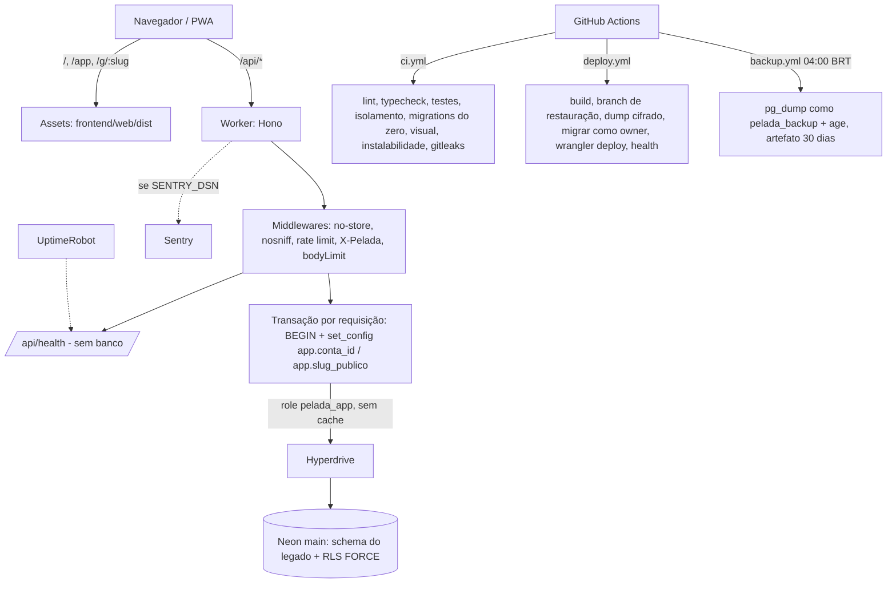

# Fundação — Design

**Spec**: `.specs\features\fundacao\spec.md`
**Status**: Approved (usuário, 2026-10-24)

> Arquitetura comum do projeto (AD-001). Diretriz do usuário: **"se a stack for a mesma, reaproveitar o máximo possível"** (AD-002). Os caminhos `legado:` são relativos a `C:\Leandro\Projetos\GestaoDaPelada`.

---

## Architecture Overview

É um Worker único na Cloudflare. Os assets estáticos são servidos sem custo de CPU, e `/api/*` passa pelo Hono. O Hono conecta no Neon pelo Hyperdrive, com uma transação por requisição que define o contexto de RLS. O CI e o deploy rodam no GitHub Actions.



---

## Code Reuse Analysis

### Existing Components to Leverage

Política (AD-002): o que é infra, ferramenta ou visual é **copiado** do legado e ajustado só no que a spec muda. Os testes do legado são copiados **quando provam um critério da spec**; cada teste copiado é ligado a um `FUN-NN` no `tasks.md`, e o que não prova critério nenhum fica de fora. A regra "testes nascem do critério de aceite" é cumprida pela ligação teste→critério, conferida pelo verificador.

| Componente | Legado | Como usar |
| -------------------- | ------------------- | ------------------------- |
| Estrutura do monorepo, `package.json` raiz, `pnpm-workspace.yaml` (`minimumReleaseAge`, `trustPolicy`), `tsconfig.base.json`, `.prettierrc.json`, `.gitattributes`, `.gitleaks.toml` | raiz | Copiar. Node 22 → 24 em `.nvmrc`, `engines` e imagens |
| ESLint com o plugin próprio (domínio sem I/O, `semRelogio`, zonas de import) | `eslint.config.mjs`, `eslint/` | Copiar e retirar as regras de telas e rotas que ainda não existem |
| Checagens do CI (migração aditiva, URLs absolutas, `wrangler deploy` único, actions fixadas por SHA, ids de tarefa) e os testes delas | `backend/scripts/checagens/` | Copiar. Ajustar a migração aditiva ao nome de arquivo do `node-pg-migrate` (FUN-54) |
| Trava de host (`exigirHostPermitido`) | `backend/scripts/` | Copiar. Usada por `migrar` e `seed` (FUN-05) |
| As 13 migrations SQL | `backend/api/src/infraestrutura/db/migracoes/*.sql` | Concatenar, sem alterar, na linha de base `…_linha-de-base.sql`. Cópia literal como fixture de teste (FUN-08, FUN-09) |
| Cliente `pg` por requisição via Hyperdrive, com `waitUntil` para fechar | `backend/api/src/infraestrutura/db/cliente.ts` | Copiar. Envolver na transação de contexto (FUN-16) |
| Cadeia de middlewares (`semCache`, `semSniff`, limite de taxa, `X-Pelada`, `bodyLimit`) | `backend/api/src/entrada/app.ts:43-66`, `middlewares/` | Copiar só os middlewares; as rotas vêm nas features |
| Config do vitest da API e apoio de teste (banco temporário, fábrica com limpeza, contagem de linhas por tabela) | `backend/api/vitest.config.ts`, `test/apoio/` | Copiar. Migrar para `@cloudflare/vitest-plugin` (codemod oficial) |
| Teste de config do `wrangler.jsonc` (lista fechada de chaves) | `backend/api/test/wrangler.test.ts` | Copiar e atualizar as chaves |
| Workflows `ci.yml`, `deploy.yml`, `backup.yml` e as actions `preparar-node` e `dump-cifrado` | `.github/` | Copiar. Ajustes no componente CI/CD abaixo |
| Branches de restauração (manter 2) | `backend/scripts/ops/restauracao-neon*.ts` | Copiar |
| Runbook de deploy, rollback e restauração | `backend/DEPLOY.md` | Base do `docs/runbook.md` |
| `frontend/web`: `estilos/`, `public/fontes`, `public/icones`, `config/tokens.ts`, `config/manifesto.ts`, `public/_headers`, `pwa/` (instalação, faixa de nova versão, regras do SW), `app/App.tsx`, `dados/cliente.ts` e `dados/consultas.ts`, componentes base, Stylelint | `frontend/web/` | Copiar com os testes (FUN-29 a FUN-35) |
| Comparação visual | `frontend/web/e2e/ferramentas/comparar-visual*.mjs` | Copiar. O `telas.json` aponta para `.specs/mockup/` |
| Mockup (142 telas, tokens, fontes e ícones) | `.md/mockup/` | Copiar para `.specs/mockup/` (premissa aprovada) |
| ADRs 001 a 023 | `.md/adr/` | Copiar para `.md/adr/`, preservando o histórico. As decisões novas continuam a partir do 024 com `Supersedes:` |

### Integration Points

| System | Integration Method |
| -------------- | --------------------------------------- |
| Neon (projeto e branch `production` do legado) | O mesmo Hyperdrive (`id` do legado) passa a usar a origem `pelada_app`. As migrations rodam com o owner atual das tabelas |
| Cloudflare | Worker novo `gestaodapelada`, com rota `gestaodapelada.ljssoftware.com.br` (`custom_domain`). O Worker antigo `pelada` é removido antes da 1ª migração (FUN-45) |
| GitHub | Repositório novo e environment `producao`. Os secrets têm os mesmos nomes do legado (`NEON_*`, `BACKUP_CHAVE`, `CLOUDFLARE_*`), mais `SENTRY_DSN` (opcional) |

---

## Components

### C1. Monorepo e ferramentas

- **Purpose**: estrutura, scripts padrão e regras de qualidade (FUN-01, FUN-02, FUN-06, FUN-31).
- **Location**: raiz, `eslint/`, `backend/*/package.json`, `frontend/web/package.json`
- **Interfaces**: `pnpm lint | typecheck | test | migrar | seed | dev` na raiz.
- **Dependencies**: Node 24, pnpm 11, TypeScript 5.9, ESLint 10, Vitest 4, Prettier.
- **Reuses**: tudo do legado (tabela acima).

### C2. Migrations e linha de base

- **Purpose**: schema versionado com `node-pg-migrate` 9, reaproveitando o banco atual (FUN-07 a FUN-10, FUN-54).
- **Location**: `backend/api/src/infraestrutura/db/migracoes/` (arquivos `.sql` com `-- Up Migration`), `backend/scripts/migrar.ts`
- **Interfaces**:
  - `pnpm migrar [--alvo local|producao]`: detecta o estado e aplica.
  - `detectarEstado(db): 'vazio' | 'legado' | 'gerenciado' | 'parcial'`
    - `vazio`: nenhuma tabela da aplicação.
    - `legado`: `migracoes_aplicadas` tem exatamente os 15 nomes do legado, não existe `pgmigrations`, e a impressão digital do schema bate com a da linha de base.
    - `gerenciado`: `pgmigrations` existe.
    - `parcial`: qualquer outro estado. Aborta e lista as diferenças.
  - Para `legado`: executa `node-pg-migrate up 1 --fake` (registra a linha de base) e depois `up`.
  - `impressaoDigital(db): string`: hash de tabelas, colunas, tipos, restrições, índices e triggers, lido do `pg_catalog`, sem dados.
- **Dependencies**: `node-pg-migrate` 9 com `--no-single-transaction` (cada migration na sua transação) e o advisory lock padrão. A tabela `migracoes_aplicadas` do legado é mantida e não é mais escrita.
- **Reuses**: os SQL do legado (linha de base), a trava de host e a checagem aditiva.
- **Testes-chave**:
  - Fixture A: as 13 migrations do legado aplicadas pelo runner antigo. O `migrar` registra o estado `legado`, faz o *fake* e a impressão digital fica igual à da fixture B.
  - Fixture B: banco vazio, com `migrar` aplicando tudo.
  - Fixture C: schema parcial. O `migrar` aborta sem alterar nada.

### C3. Roles e RLS

- **Purpose**: isolamento por grupo no próprio Postgres (FUN-11 a FUN-15, FUN-17).
- **Location**: as migrations `…_roles.sql` e `…_rls.sql`, e `backend/api/test/isolamento/`
- **Interfaces (SQL)**:
  - Roles, criadas por SQL (assim não entram no `neon_superuser`):
    - `pelada_app NOLOGIN NOBYPASSRLS`;
    - `pelada_backup NOLOGIN`.
    - O `LOGIN PASSWORD` é definido uma vez pelo runbook, fora do repositório. No local, quem define é o `seed`, a partir do `.env`.
    - **owner** = a role dona das tabelas no Neon (`neondb_owner`), usada só pelo `migrar`.
  - Grants de `pelada_app`: `SELECT, INSERT, UPDATE` nas tabelas de negócio. `DELETE` só onde o legado apaga por regra: `presencas`, `notas`, `escalacoes`, `vinculos_admin`, `pagamentos_mes`, `lancamentos`, `habilidades`, `partidas` e `jogadores` (sem histórico). `sessoes` ganha `SELECT` e `DELETE` juntos na `conta-e-acesso`. **Nunca** `TRUNCATE` nem DDL.
  - Funções `app_conta_id()` e `app_slug_publico()`: `nullif(current_setting('app.…', true), '')`. A função `grupos_visiveis()` é `SECURITY DEFINER` com `search_path` fixo e retorna:
    - com conta: os `grupo_id` com vínculo da conta;
    - com slug: o `id` do grupo do slug;
    - sem contexto: vazio.
  - Policies em toda tabela com `grupo_id`, e em `grupos` (por `id`):
    - leitura com `USING (grupo_id IN (SELECT grupos_visiveis()))`;
    - escrita com `WITH CHECK` igual, mais `app_conta_id() IS NOT NULL`. Esse segundo termo bloqueia a escrita pelo slug público (FUN-14).
  - `ENABLE` + `FORCE ROW LEVEL SECURITY` nessas tabelas.
  - `pelada_backup`: `SELECT` em tudo e policy de leitura total (`USING (true)`) só para ela. O dump usa `pg_dump --enable-row-security`.
  - Tabelas sem `grupo_id` (`contas`, `sessoes`, `tentativas_login`, `pedidos_reset`): ficam fora do FUN-12 e recebem RLS própria na `conta-e-acesso`. Na fundação, `pelada_app` só tem acesso a elas pelo que a feature 2 definir. Até lá, ficam sem grant.
  - `auditoria` e `eventos_uso` têm a coluna `grupo_id`: entram no FUN-12 (RLS com `FORCE`, policies e a policy `USING (true)` de `pelada_backup`) e seguem sem grant para `pelada_app` até a `conta-e-acesso` (decisão do usuário em 2026-10-24).
- **Testes-chave**: o isolamento roda **no banco**, como `pelada_app`, sem passar pela API. Para cada tabela com `grupo_id` são três cenários:
  - A lê só os próprios dados;
  - B não lê, não insere, não altera e não apaga nada de A;
  - o slug não escreve, e sem contexto o resultado é zero linhas.
  - Um meta-teste falha se surgir uma tabela com `grupo_id` sem caso de isolamento. A suíte de rotas do legado (`isolamento/casos.ts`) volta nas features, com as rotas.
- **Reuses**: o padrão de cenário com dois grupos de `test/apoio/cenario-acesso.ts`.

### C4. API: Worker, Hono e contexto de banco

- **Purpose**: entrada única, saúde e transação de contexto (FUN-16, FUN-18 a FUN-22, FUN-26).
- **Location**: `backend/api/src/entrada/` (`worker.ts`, `app.ts`, `middlewares/`, `rotas/health.ts`) e `backend/api/src/infraestrutura/db/`
- **Interfaces**:
  - `GET /api/health → 200 {"status":"ok","versao": env.VERSAO}`, sem banco. `VERSAO` é injetada por `--var VERSAO:<sha>`.
  - Middleware `comBanco`: abre o cliente só na primeira consulta e faz `BEGIN` (`READ ONLY` em GET e HEAD). Depois executa `SELECT set_config('app.conta_id', $1, true), set_config('app.slug_publico', $2, true)`, com parâmetros. Termina com `COMMIT` se a resposta for menor que 400, ou `ROLLBACK` caso contrário, e fecha a conexão no `waitUntil`.
  - `c.var.db: Kysely<Banco>` é sempre transacional. Abrir outra transação dentro dela é proibido (herança de `transacao.ts`).
- **Dependencies**: Hono 4, Kysely 0.29, `pg` 8, Hyperdrive com `--caching-disabled` (o deploy confere isso, como no legado).
- **Reuses**: `cliente.ts`, middlewares e `limite-taxa.ts`.

### C5. Observabilidade

- **Purpose**: erros no Sentry quando houver DSN, e monitor de uptime (FUN-23 a FUN-25).
- **Location**: `backend/api/src/entrada/worker.ts`, `frontend/web/src/app/observabilidade.ts`
- **Interfaces**:
  - No Worker, `@sentry/hono/cloudflare` (`sentry(app, env => …)`), ligado só com `env.SENTRY_DSN`.
  - No front, `@sentry/react` com `import.meta.env.VITE_SENTRY_DSN`.
  - `release = VERSAO`.
  - `beforeSend` remove `request.data`, `request.cookies`, os cabeçalhos `cookie` e `authorization`, e e-mails por regex em mensagem e breadcrumbs (`PREMISSA`: o hook existe na 11.x; confirmar na implementação).
- **Dependencies**: `@sentry/cloudflare`, `@sentry/hono` e `@sentry/react` na 11.9.

### C6. Front: shell PWA

- **Purpose**: visual do legado, instalação e offline (FUN-29 a FUN-37).
- **Location**: `frontend/web/`
- **Interfaces**:
  - Rota `/`: página provisória. Rota `*`: a SPA.
  - Página offline em `public/offline.html`, servida pelo SW, com fallback de navegação.
  - Telas ativas na comparação visual da fundação: `padrao--erro-rede`, `padrao--carregando-lista` e `t03-indisponivel--erro`, expostas por rotas de vitrine **só no build de teste** (`VITE_VITRINE=1`), nunca em produção.
  - A página provisória e a offline reaproveitam a casca de `t03-indisponivel`. Se faltar estado no mockup, cria-se o par HTML no `.specs/mockup/` pela `mockup-visual` (modo módulo).
- **Dependencies**: React 19, React Router 8, TanStack Query 5, Vite 8, `vite-plugin-pwa` 2 (`injectManifest`), Workbox 7.
- **Reuses**: o `frontend/web` do legado, sem as telas de negócio.

### C7. CI/CD e backup

- **Purpose**: FUN-38 a FUN-48 e FUN-55 a FUN-56.
- **Location**: `.github/workflows/{ci,deploy,backup}.yml` e `.github/actions/`
- **Ajustes sobre o legado**:
  - O CI ganha o job de isolamento no banco, o job de migrations do zero com as três fixtures do C2 e o job de instalabilidade (Playwright: manifest, SW controlando a página, ícones, offline). O job de Lighthouse sai (AD-005).
  - No deploy, a migração usa `NEON_URL_MIGRACAO` (owner) e o dump pré-deploy usa a mesma URL. Depois do deploy, `/api/health` precisa devolver `versao == github.sha`. Há falha explícita se `URL_PUBLICA` estiver vazia (FUN-56). O `rollback` deixa de ter `|| true` e a falha passa a aparecer no job.
  - O backup usa `NEON_URL_BACKUP` (`pelada_backup`) com `--enable-row-security` em `dump-cifrado.sh`.
  - Concurrency `deploy-producao` com `cancel-in-progress: false`.

### C8. Documentação

- **Purpose**: FUN-49 a FUN-52.
- **Location**: `README.md`, `docs/runbook.md`, `.md/` (PRD, PRD-TECNICO, SDD, GUARDRAILS, THREAT-MODEL, `adr/`), `CLAUDE.md` da raiz.
- **Reuses**: `backend/DEPLOY.md` e os `.md/` do legado como ponto de partida, atualizados para a stack nova.

---

## Data Models

Na fundação, o modelo é o do legado (`analise-legado.md` §3), sem mudança de colunas. Tudo o que é novo é de controle:

```sql
-- controle do node-pg-migrate (padrão)
pgmigrations (id serial, name varchar, run_on timestamp)
-- mantida do legado, só leitura a partir de agora
migracoes_aplicadas (nome text PK, aplicada_em timestamptz)
```

**Relationships**: a RLS liga cada tabela de negócio a `grupos.id` e, por meio de `vinculos_admin(conta_id, grupo_id)`, à conta da sessão.

---

## Error Handling Strategy

| Error Scenario | Handling | User Impact |
| -------------- | ------------- | ---------------- |
| Banco local fora do ar | `migrar`, `seed` e `dev` param com "Rode `docker compose up -d`" (FUN-53) | Desenvolvedor vê o passo que falta |
| Schema parcial | `migrar` aborta antes de qualquer DDL e lista as diferenças (FUN-10) | Nada é alterado |
| Migração falha no deploy | Cada migration reverte a si mesma. O job para antes do `wrangler deploy`; o runbook indica a branch de restauração (FUN-42) | O app antigo segue no ar |
| Erro na requisição com transação aberta | `ROLLBACK`, depois 500 genérico e Sentry, se houver DSN | Mensagem de erro do padrão do legado (`ErroRede`) |
| Sem contexto de RLS | Zero linhas (FUN-15) | 404 nas rotas das features |
| Sentry fora do ar ou sem DSN | Nenhum envio; a requisição não espera (FUN-24) | Nenhum |
| Health com versão diferente após o deploy | Job vermelho com `wrangler rollback` | O app volta à versão anterior |

---

## Risks & Concerns

| Concern | Location (file:line) | Impact | Mitigation |
| ------- | -------------------- | ------ | ---------- |
| `SET LOCAL` / `set_config(…, true)` pelo Hyperdrive (modo transação) não confirmado na doc | pesquisa 2026-10-24, item 2 | O contexto de RLS pode vazar entre requisições ou se perder | **Spike S1** (primeira tarefa) numa branch Neon descartável com Hyperdrive remoto: duas requisições concorrentes com contas diferentes. Fallback: conexão direta por requisição sem pooling (`pg.Client` com `ssl`), aceitando a latência maior. **Resolvido em 2026-10-24 (S1): sim com ressalvas, sem vazamento em 100 de 100 requisições concorrentes pelo Hyperdrive remoto; fallback não necessário** (`.specs/spikes/s1-contexto-rls/registro.md`). A forma testada foi `SET LOCAL ROLE` dentro da transação; T11 e T18 decidem uma forma só e o teste de T18 cobre a escolhida |
| `neondb_owner` pode ter `BYPASSRLS` herdado, ou ser afetado pelo `FORCE` | pesquisa, item 3 | Migrations de dados enxergando zero linhas, ou o owner ignorando a RLS | **Spike S2**: conferir `rolbypassrls`/`relforcerowsecurity` e testar como cada role enxerga as linhas. O teste de isolamento roda como `pelada_app`, que nunca tem bypass. Migrations de dados futuras usam a role com a semântica confirmada no S2. **Resolvido em 2026-10-24 (S2): `neondb_owner` tem `rolbypassrls = true` e enxerga todas as linhas mesmo com `FORCE`**; a API nunca conecta como owner, e as migrations rodam como owner por isso (`.specs/spikes/s2-owner-force-dump/registro.md`) |
| `pg_dump` com RLS ativa | `legado: .github/actions/dump-cifrado/dump-cifrado.sh:37` | Backup falhando | **Spike S2** cobre o `--enable-row-security` com policy `USING (true)` para `pelada_backup`. Fallback: dump com o owner. **Resolvido em 2026-10-24 (S2): sim com ressalvas.** Com a policy, o dump restaura todas as linhas; sem ela, o dump com `FORCE` sai vazio com exit 0. T12 cria a policy em toda tabela com `grupo_id`, T40 testa a contagem restaurada, e o cliente `pg_dump` tem a versão principal do servidor (hoje 16). O destino da restauração precisa ter as roles criadas antes |
| `@cloudflare/vitest-pool-workers` descontinuado; o ADR-018 travava a `compatibility_date` | `legado: backend/api/vitest.config.ts`, ADR-018 | Testes da API quebrando na migração | Codemod oficial para `@cloudflare/vitest-plugin`. `compatibility_date` igual à data máxima aceita pelo workerd do plugin; ADR novo com `Supersedes: 018` |
| Worker antigo e Worker novo no mesmo banco | — | O antigo quebra com a RLS | Removido antes da 1ª migração (FUN-45), com confirmação específica |
| `SECURITY DEFINER` em `grupos_visiveis()` | migration `…_rls.sql` | Escalada se o `search_path` puder ser manipulado | `SET search_path = public, pg_temp` na função, dono = owner, e `REVOKE ALL … FROM PUBLIC` com `GRANT EXECUTE` só a `pelada_app` |
| Rate Limiting API sem status de GA confirmado na doc | pesquisa, item 4 | Binding indisponível | Já roda em produção no legado (`wrangler.jsonc:19-22`), com o mesmo tipo de conta |
| Testes copiados do legado que não provam um critério novo | política de reuso | Cobertura enganosa | Cada teste copiado é ligado a um `FUN-NN` no `tasks.md`. O verificador recusa ligação sem asserção correspondente |
| `checar-tokens.py` aponta para `.specs/mockup` e o legado tinha `.md/mockup` | `legado: .claude/scripts/checar-tokens.py` | Checagem de tokens falhando | No projeto novo o mockup fica em `.specs/mockup/`, o caminho esperado. Entra no CI (FUN-29) |
| `vite.config.ts` depende de `vitest` içado da raiz | `legado: frontend/web/vite.config.ts:5` | Quebra com pnpm estrito | Declarar `vitest` no `frontend/web/package.json` |

---

## Tech Decisions (only non-obvious ones)

| Decision | Choice | Rationale |
| ----------------- | --------------- | ------------- |
| Reuso | Copiar infra, ferramentas, visual e testes ligados a critérios (AD-002) | Diretriz do usuário. Mesma stack |
| Linha de base do schema | SQL do legado concatenado, `--fake` no estado `legado`, impressão digital do schema (AD-003) | D5: reaproveitar o banco sem DDL nem risco de dados |
| Transação | Uma migration por transação (`--no-single-transaction`), com advisory lock | Requisito do padrão. Falha isolada |
| Modelo de RLS | Contexto por `set_config(…, true)` na transação; `grupos_visiveis()` `SECURITY DEFINER`; escrita só com conta (AD-004) | D1. Evita a recursão de policy em `vinculos_admin` |
| Instalabilidade no lugar do Lighthouse | Teste Playwright (AD-005) | Decisão do usuário; a categoria PWA saiu do Lighthouse |
| ADRs | Copiar os 23 do legado e numerar os novos a partir do 024 (AD-006) | Mantém o histórico das decisões que continuam valendo |
| Nome do Worker | `gestaodapelada` | Igual ao subdomínio (D4) |
| Telas de vitrine para comparação visual | Só no build de teste (`VITE_VITRINE`) | Comparar componentes sem expô-los em produção |
