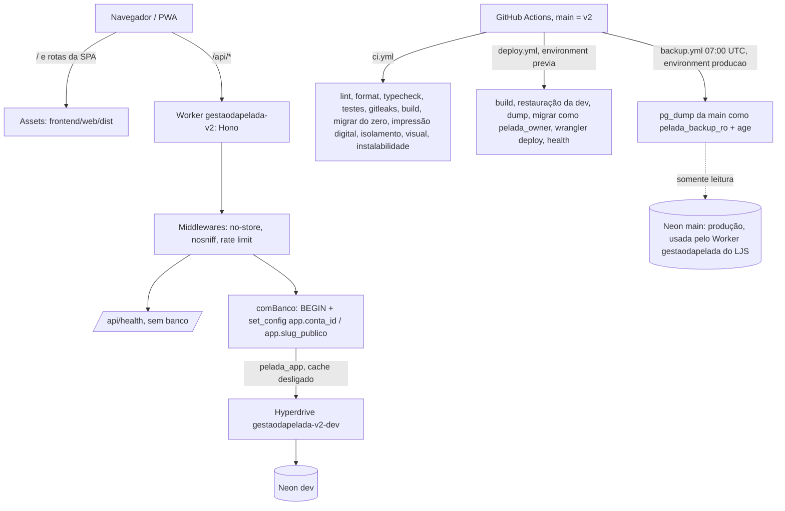

# Fundação — Design

**Spec**: `.specs/features/fundacao/spec.md`
**Status**: Approved (usuário, 2026-11-03)

> Arquitetura comum do projeto (AD-001). Reuso **do zero total** (AD-002): do `GestaoDaPelada_LJS` só se copiam as 23 migrações, sem alteração (AD-003), e os ativos de `.specs/mockup/`. O LJS é consultado, nunca copiado. Mapa de reuso: `reuso.md`. Os caminhos `ljs:` são relativos a `C:\Leandro\Projetos\GestaoDaPelada_LJS` @ `e557292`.

---

## Architecture Overview

É um Worker único na Cloudflare. Os assets estáticos saem sem custo de CPU, e `/api/*` passa pelo Hono. O Hono conecta no Neon pelo Hyperdrive, com uma transação por requisição que define o contexto da RLS. Até a paridade, o único alvo publicado é a prévia `gestaodapelada-v2`, ligada à branch `dev` do Neon (AD-004). A produção do LJS (`gestaodapelada` + `main` do Neon) só é tocada pelo `backup.yml`, que é somente leitura.

---

## Code Reuse Analysis

### Existing Components to Leverage

| Componente | Origem | Como usar |
| --- | --- | --- |
| As 23 migrações SQL | `ljs:backend/api/src/infraestrutura/db/migracoes/*.sql` | Copiar **byte a byte, com o mesmo nome** (AD-003). Comando no `reuso.md` |
| `tokens.css`, fontes, ícones | `.specs/mockup/{tokens.css,fontes/,icones/}` (já no repo, copiados do LJS em `c8d7196`) | Copiar para `frontend/web/src/estilos/` e `frontend/web/public/` (FUN-30). Comando no `reuso.md` |
| Classes e marcação dos componentes | `.specs/mockup/base.css` e `.specs/mockup/telas/*.html` | **Referência** para escrever do zero os componentes React e seus CSS Modules (FUN-31). Não se importa `base.css` no app |
| Telas de vitrine | `.specs/mockup/telas/{padrao--erro-rede,padrao--carregando-lista,t03-indisponivel--erro}.html` | Alvo da comparação visual (FUN-38) |
| Instrução de instalação iOS | `.specs/mockup/telas/t01-ranking--instalar-iphone.html` | Alvo de FUN-36 |
| Padrões do LJS (transação por requisição com `set_config`, `migrar` com detecção de estado, `dump-cifrado`) | `ljs:backend/api/src/infraestrutura/db/transacao-da-requisicao.ts:109`, `ljs:.../migracoes/migrar.ts:77-94`, `ljs:.github/actions/dump-cifrado/` | **Só consulta**: confirmam que o desenho funciona em produção. O código é escrito de novo |

### Integration Points

| System | Integration Method |
| --- | --- |
| Neon `main` (produção) | Só o `backup.yml` lê, com `NEON_URL_BACKUP` (`pelada_backup_ro`) do environment `producao`, que já existe no repo. Nada da v2 escreve nela antes da paridade (FUN-28) |
| Neon `dev` | Alvo da prévia. Migração com `pelada_owner`, runtime com `pelada_app` via um Hyperdrive novo, `gestaodapelada-v2-dev`, criado pelo usuário pelo runbook |
| Cloudflare | Worker novo `gestaodapelada-v2` em `workers.dev`. O Worker `gestaodapelada` do LJS não é tocado (FUN-28) |
| GitHub | O mesmo repo `GestaoDaPelada_LJS`. A branch `legado` recebe a main atual, e a `main` passa a ser a v2 (AD-005). Há um environment novo, `previa`, com os secrets da `dev` e da Cloudflare |

---

## Components

### C1. Monorepo e ferramentas

- **Purpose**: estrutura, scripts e qualidade (FUN-01, FUN-02, FUN-06, FUN-32).
- **Location**: raiz (`package.json`, `pnpm-workspace.yaml`, `tsconfig.base.json`, `.nvmrc`, `.gitattributes` com `* text=auto eol=lf`, `eslint.config.mjs`, `.prettierrc.json`, `.gitleaks.toml`), um `package.json` por pacote.
- **Interfaces**: `pnpm lint | format:check | typecheck | test | migrar | seed | dev` na raiz, com `pnpm -r`.
- **Dependencies**: Node 24, pnpm 11.23, TypeScript 5.9, ESLint (regra `no-restricted-imports` em `backend/dominio` para FUN-06), Prettier, Vitest 4, Stylelint (FUN-32).
- **Reuses**: nada do LJS. As versões são as do LJS (`ljs:package.json:6,35`), ainda atuais, conferidas na instalação.

### C2. Migrações, `migrar` e impressão digital

- **Purpose**: schema versionado com `node-pg-migrate` 9 sobre o banco herdado (FUN-07 a FUN-10, FUN-56).
- **Location**: `backend/api/src/infraestrutura/db/migracoes/` (os 23 `.sql` copiados e os futuros da v2), `backend/api/src/infraestrutura/db/migrar.ts`, `backend/api/src/infraestrutura/db/esquema.ts`, `backend/scripts/migrar.ts`.
- **Interfaces**:
  - `pnpm migrar`: lê `DATABASE_URL_MIGRACAO` (role dona do schema), aplica a trava de host fora do deploy e chama `migrar(url)`.
  - `detectarEstado(db): 'vazio' | 'gerenciado' | 'divergente'`
    - `vazio`: nenhuma tabela em `public`.
    - `gerenciado`: `pgmigrations` existe e seus nomes são um prefixo, na ordem, da lista de arquivos da v2.
    - `divergente`: qualquer outro caso (tabelas sem `pgmigrations`, nome registrado que não existe na v2, ordem diferente). Aborta antes de qualquer escrita e lista as diferenças (FUN-10).
  - `migrar` em `vazio` ou `gerenciado`: runner com `migrationsTable: 'pgmigrations'`, `singleTransaction: false`, `checkOrder: true` e o advisory lock padrão. Na produção, todas as 23 constam como aplicadas, então zero DDL (FUN-09).
  - `lerEsquema(db): string[]`: uma linha por item, ordenada, lida do `pg_catalog`. Cobre tabelas, colunas, restrições, índices, triggers, **funções (assinatura, `SECURITY DEFINER`, `search_path` e hash do corpo), policies (comando, roles, `USING`, `WITH CHECK`), `relrowsecurity` e `relforcerowsecurity`, grants de tabela e de coluna por role, atributos das roles `pelada_*` e extensões**. Ignora `pgmigrations`. O LJS não cobria funções, policies nem grants (`ljs:.../migracoes/esquema.ts:15-33`), e FUN-08 exige.
  - `migracoes/esquema-producao.txt`: referência versionada, gerada por `pnpm esquema:gerar` num banco vazio migrado só com as 23.
- **Testes-chave**:
  - Banco vazio, depois `migrar`: o esquema é igual à referência (FUN-08).
  - Banco com as 23 aplicadas, depois `migrar` de novo: um event trigger `ddl_command_start` conta zero DDL, a `pgmigrations` e a contagem de linhas ficam iguais (FUN-09).
  - Tabela solta sem `pgmigrations`, ou nome desconhecido na `pgmigrations`: aborta, nada muda e a lista de diferenças aparece (FUN-10).
  - Checagem aditiva: migração nova com `DROP TABLE|COLUMN`, `ALTER ... TYPE` ou `RENAME` reprova no CI, salvo uma linha `-- excecao-aditiva: AD-NNN` (FUN-56). As 23 copiadas ficam numa lista fechada de exceções, com o hash de cada arquivo.

### C3. Isolamento no banco

- **Purpose**: provar no Postgres a RLS herdada (FUN-11 a FUN-15, FUN-17, FUN-19).
- **Location**: `backend/api/test/isolamento/`, `backend/api/test/apoio/banco.ts`.
- **Interfaces**:
  - `bancoDeTeste()`: cria um database `teste_<aleatório>` no Postgres local ou do CI, migra e remove no `finally`. Recusa host que não seja `localhost`, `127.0.0.1` ou `postgres` (o serviço do CI) (FUN-19).
  - `comoApp(db, contexto, fn)`: `SET LOCAL ROLE pelada_app` mais `set_config('app.conta_id' | 'app.slug_publico', …, true)` dentro de uma transação. Os GUCs são os da migração `rls` (`ljs:.../migracoes/1792843320000_rls.sql:5-11`).
- **Testes-chave**:
  - **Matriz política × comando**: para cada tabela com `grupo_id` e para `grupos`, um caso por SELECT, INSERT, UPDATE e DELETE, com conta A, conta B, slug público e sem contexto. Inclui UPDATE e DELETE sem `WHERE` (FUN-13 a FUN-15, FUN-17). As 15 tabelas da fundação são as de `ljs:.../1792843320000_rls.sql:33-59`; as tabelas de conta ficam com a `conta-e-acesso`.
  - Meta-teste: tabela com `grupo_id` sem caso na matriz, ou sem `FORCE`, reprova (FUN-12).
  - Roles: `pelada_app` sem `BYPASSRLS` e sem `CREATE`, e sem `TRUNCATE` em nenhuma tabela. `pelada_backup_ro` só com `SELECT` (FUN-11).
- **Dependencies**: os testes rodam como superusuário `postgres` local e trocam para `pelada_app` com `SET LOCAL ROLE`.

### C4. API: Worker, Hono e contexto de banco

- **Purpose**: entrada única, saúde e transação de contexto (FUN-16, FUN-18, FUN-20 a FUN-23, FUN-26).
- **Location**: `backend/api/src/entrada/{worker.ts,app.ts,middlewares/,rotas/health.ts}`, `backend/api/src/infraestrutura/db/{cliente.ts,transacao.ts}`.
- **Interfaces**:
  - `GET /api/health → 200 {"status":"ok","versao": env.VERSAO}`, sem banco.
  - Middlewares: `semCache` (`Cache-Control: no-store`), `semSniff`, `limiteTaxa(binding)` (429 com `Retry-After`).
  - `comBanco(contexto)`: o cliente `pg` abre só na primeira consulta, pelo `HYPERDRIVE.connectionString`. Faz `BEGIN` (`READ ONLY` em GET e HEAD), depois `SELECT set_config('app.conta_id',$1,true), set_config('app.slug_publico',$2,true)`. Termina com `COMMIT` se o status for menor que 400, senão `ROLLBACK`, e fecha no `waitUntil`. `c.var.db: Kysely<Banco>`. Na fundação, nenhuma rota de negócio usa o `comBanco`; ele é provado por teste com uma rota de teste só no ambiente de teste.
  - `wrangler.jsonc`: `name: gestaodapelada-v2`, `nodejs_compat`, `assets` (`frontend/web/dist`, SPA, `run_worker_first: ["/api/*"]`), 4 bindings de rate limit (FUN-26) e `vars` (`VERSAO`, `URL_PUBLICA`). Sem `routes` de domínio próprio. Usa `workers_dev: true`.
- **Dependencies**: Hono 4, Kysely 0.29, `pg` 8, `@cloudflare/vitest-plugin`, wrangler 4. Hyperdrive com `--caching-disabled` (FUN-18), conferido no deploy.

### C5. Observabilidade

- **Purpose**: Sentry opcional (FUN-24, FUN-25) e monitor de uptime no runbook (FUN-52).
- **Location**: `backend/api/src/entrada/observabilidade.ts`, `frontend/web/src/app/observabilidade.ts`.
- **Interfaces**: liga só com `SENTRY_DSN` / `VITE_SENTRY_DSN`. `release = VERSAO`. O `beforeSend` remove o corpo, os cookies, os cabeçalhos `cookie` e `authorization`, e e-mails por regex.
- **Dependencies**: `@sentry/cloudflare`, `@sentry/react` (versão atual conferida na instalação).

### C6. Front: shell PWA

- **Purpose**: visual do mockup, instalação e offline (FUN-30 a FUN-38).
- **Location**: `frontend/web/`.
- **Interfaces**:
  - Rotas: `/` com a página provisória ("Em breve") e `*` com a SPA (404 no estilo do mockup).
  - Componentes da fundação, escritos do zero a partir de `base.css` e das 3 telas de vitrine: `Casca`, `Barra`, `EstadoErro` (com Tentar de novo), `EsqueletoLista`, `Botao`, `Marca`, `AvisoInstalarIphone`. Cada um com CSS Module, só `var(--…)` dos tokens, teste de renderização e axe. Os demais componentes nascem nas features que os usam.
  - Página offline em `public/offline.html` e página provisória: usam a casca de `t03-indisponivel--erro` com o texto próprio, porque o mockup não tem tela offline (AD-007).
  - Rotas de vitrine `/_vitrine/<id>` só no build de teste (`VITE_VITRINE=1`), nunca na prévia (FUN-38).
  - PWA: `vite-plugin-pwa` (`injectManifest`), service worker com precache do shell, fallback de navegação para `offline.html` e handlers vazios de `push` e `notificationclick` (FUN-33 a FUN-35).
  - Cabeçalhos dos assets em `public/_headers`: CSP (`default-src 'self'`, sem `unsafe-inline` em script), `X-Content-Type-Options: nosniff`, `Referrer-Policy: strict-origin-when-cross-origin` e `Strict-Transport-Security`. Um teste e2e lê os cabeçalhos do `wrangler dev` contra o build (FUN-29). O `workers.dev` só serve HTTPS.
  - Comparação visual: Playwright tira print da rota de vitrine e do HTML do mockup nos dois viewports e compara pixel a pixel com até 1% de diferença (FUN-38). O script é escrito do zero.
- **Dependencies**: React 19, React Router, TanStack Query 5, Vite 8, `vite-plugin-pwa`, Workbox, Playwright 1.64, `@axe-core/playwright` ou `vitest-axe`.

### C7. CI, deploy e backup

- **Purpose**: FUN-40 a FUN-50, FUN-57 e FUN-58.
- **Location**: `.github/workflows/{ci,deploy,backup}.yml`, `.github/actions/{preparar-node,dump-cifrado}/`, `backend/scripts/ops/`.
- **Interfaces**:
  - `ci.yml` (push e PR): jobs `qualidade` (lint, format, typecheck, gitleaks, checagens), `testes` (unitários e Worker), `banco` (serviço `postgres:18`: migrar do zero, impressão digital, isolamento, FUN-09 e FUN-10), `web` (build, instalabilidade, comparação visual). Actions fixadas por SHA.
  - `deploy.yml`: só `workflow_dispatch`, com `if: github.ref == 'refs/heads/main'`, `environment: previa` e `concurrency: { group: deploy-previa, cancel-in-progress: false }`. Passos de FUN-42, com o dump cifrado da `dev` feito por `pelada_backup_ro` (AD-010). O alvo vem fixo do `wrangler.jsonc` (`gestaodapelada-v2`), e um teste falha se o `wrangler.jsonc` ou o `deploy.yml` citarem `gestaodapelada` sem `-v2`, `routes` ou o environment `producao` (FUN-28).
  - Branch de restauração: `backend/scripts/ops/restauracao-neon.ts`, pela API do Neon (`NEON_API_KEY`, `NEON_PROJECT_ID` no environment `previa`), com a `dev` como pai, mantendo as 2 mais recentes.
  - `backup.yml`: `schedule: '0 7 * * *'` e `workflow_dispatch`, `environment: producao`, `pg_dump -Fc --enable-row-security` com `NEON_URL_BACKUP`, `age -r "$BACKUP_CHAVE"` e `actions/upload-artifact` com `retention-days: 30`. Com `set -euo pipefail`, só publica se dump e cifragem terminarem (FUN-49). O cliente `pg_dump` é da versão 18, igual à do servidor.
- **Secrets novos (usuário, runbook)**: no environment `previa`, `NEON_URL_DEV_MIGRACAO`, `NEON_API_KEY`, `NEON_PROJECT_ID`, `CLOUDFLARE_API_TOKEN`, `CLOUDFLARE_ACCOUNT_ID` e `URL_PUBLICA`. O environment `producao` já tem `NEON_URL_BACKUP` e `BACKUP_CHAVE` (`ljs:.specs/liberacao.md:28`).

### C8. Troca da `main` do repositório

- **Purpose**: FUN-39 e FUN-48.
- **Procedimento** (runbook, cada push com confirmação específica do usuário):
  1. `git push origin e557292:refs/heads/legado` (a partir do clone do LJS), e conferir com `git ls-remote`.
  2. Na v2: `git remote add origin <repo LJS>` e `git push --force-with-lease=main:<sha da main remota> origin main`. É uma reescrita da `main` remota, autorizada pela AD-005. A branch `legado` preserva o histórico.
  3. No mesmo dia: `gh workflow run backup.yml` e conferir o artefato (FUN-48).
- **Ordem real (AD-008, AD-011)**: o usuário trocou a `main` antes de o `backup.yml` existir, e `legado` foi conferida no remoto antes do push. O `backup.yml` da v2 vira a primeira entrega de infraestrutura (Phases 3 e 4 do `tasks.md`).

### C9. Documentação e contexto

- **Purpose**: FUN-51 a FUN-54.
- **Location**: `README.md`, `docs/runbook.md`, `CLAUDE.md` da raiz e `.specs/projeto/testes.json`. Decisões em `.specs/STATE.md` e `.specs/decisoes/` (fluxo do Rascunho).

---

## Data Models

Sem mudança no modelo: o schema é o das 23 migrações (`ljs:.../1792843200000_linha-de-base.sql` e seguintes). Controle: `pgmigrations (id, name, run_on)` do `node-pg-migrate`, já presente na produção. A tabela `migracoes_aplicadas` (do legado) continua no banco e a v2 a ignora.

**Relationships**: a RLS liga cada tabela de negócio a `grupos.id` e, por meio de `vinculos_admin(conta_id, grupo_id)` e de `grupos_visiveis()`, à conta da sessão.

---

## Error Handling Strategy

| Error Scenario | Handling | User Impact |
| --- | --- | --- |
| Postgres local fora do ar | `migrar`, `seed` e `dev` param com "Rode `docker compose up -d`" (FUN-55) | O desenvolvedor vê o passo que falta |
| Banco divergente | `migrar` aborta antes de qualquer escrita e lista as diferenças (FUN-10) | Nada é alterado |
| `dev` do Neon divergente da `main` no primeiro deploy | `migrar` aborta (FUN-10). O runbook manda recriar a `dev` a partir da `main` | A prévia não sobe; a produção não é tocada |
| Migração falha no deploy | A migração reverte a si mesma, o job para antes do `wrangler deploy`, e o runbook indica a branch de restauração (FUN-44) | A prévia anterior segue no ar |
| Erro com transação aberta | `ROLLBACK`, 500 genérico, Sentry se houver DSN | Tela de erro do mockup |
| Sem contexto de RLS | Zero linhas (FUN-15) | Nas features, 404 |
| Sentry sem DSN ou fora do ar | Nenhum envio; a requisição não espera (FUN-25) | Nenhum |
| Health com versão diferente após o deploy | Job vermelho, com `wrangler rollback` | A prévia volta à versão anterior |
| Backup falha | Job vermelho, sem artefato (FUN-49) | Aviso do GitHub por e-mail ao dono do repo |

---

## Risks & Concerns

| Concern | Location (file:line) | Impact | Mitigation |
| --- | --- | --- | --- |
| Funções `SECURITY DEFINER` herdadas talvez sem `SET search_path` | `ljs:.../1792843560000_conta-senha-e-exclusao.sql` (4 `SECURITY DEFINER`, 3 `search_path`), levantamento de 2026-11-03 | Escalada de privilégio por `search_path` | A impressão digital do C2 lista o `search_path` de cada função. Um teste lista as `SECURITY DEFINER` sem ele e registra o resultado. A correção é uma migração aditiva na `conta-e-acesso` (fora desta feature, que não pode alterar as 23). Entra no escopo do `auditor-seguranca` na fase 7 |
| A `dev` do Neon pode não estar no mesmo estado da `main` | `ljs:docs/runbook.md:68`, ADR-030 do LJS | O primeiro deploy da prévia aborta | O runbook do C7 manda recriar a `dev` a partir da `main` antes do primeiro deploy (ação do usuário no console do Neon) |
| Secrets da API do Neon foram apagados no LJS | `ljs:.specs/liberacao.md:28` | Sem branch de restauração no deploy (FUN-42) | Uma chave nova no environment `previa`, pelo runbook |
| `pelada_owner` tem `BYPASSRLS`? | ADR-032 do LJS; o spike S2 do LJS valeu para `neondb_owner` | Migração de dados futura enxergando a RLS errado | Na fundação não há migração de dados. O CI roda migrações como `postgres` (superusuário). Conferir `rolbypassrls` na primeira migração de dados |
| Reescrever a `main` remota | C8 | Perder o LJS se a `legado` não estiver no remoto | `legado` empurrada e conferida antes, `--force-with-lease` com o SHA esperado e confirmação específica do usuário em cada push |
| Scheduled workflows só rodam na branch padrão | documentação do GitHub Actions | Um dia sem backup da produção | `backup.yml` no mesmo push e execução manual no mesmo dia (FUN-48) |
| Componentes reescritos divergem do mockup | AD-002 | Visual diferente do aprovado | Comparação visual no CI com 1% (FUN-38) nas telas ativas, que crescem a cada feature |
| Novas migrações da v2 com timestamp menor que as 23 | `checkOrder: true` | `migrar` recusa | Nome de migração nova gerado por `pnpm migracao:nova`, que usa timestamp maior que o último. Um teste confere a ordem |
| Rate Limiting binding no plano Free | pesquisa de 2026-11-03 | Bindings indisponíveis | Resolvido: já roda em produção no LJS, na mesma conta (`ljs:wrangler.jsonc:27-33`) |

---

## Tech Decisions (only non-obvious ones)

| Decision | Choice | Rationale |
| --- | --- | --- |
| Reuso | Do zero total. Só as 23 migrações e os ativos do mockup são copiados (AD-002) | Decisão do usuário |
| Histórico de migrações | As 23 copiadas com o mesmo nome, `pgmigrations` como controle, sem `--fake` (AD-003) | A produção já as registra. Nenhuma escrita na `pgmigrations` da produção |
| Prévia antes da paridade | Worker `gestaodapelada-v2` + `dev` do Neon. O deploy recusa outro alvo (AD-004) | Decisão do usuário: sem regressão para o grupo de teste |
| Repositório | O mesmo repo do LJS: main antiga na `legado`, `main` = v2 (AD-005) | Decisão do usuário. Mantém secrets e environments |
| Documentação | Fluxo do Rascunho, sem `.md/` (AD-006) | Decisão do usuário |
| Offline e página provisória | Casca de `t03-indisponivel--erro` com texto próprio (AD-007) | O mockup não tem tela offline; mantém o visual sem desenhar tela nova |
| Impressão digital | Inclui funções, policies, grants e roles | FUN-08 pede schema idêntico; a do LJS não cobria |
| Vitrine | Rotas `/_vitrine/*` só no build de teste | Comparar componentes sem expô-los na prévia |
