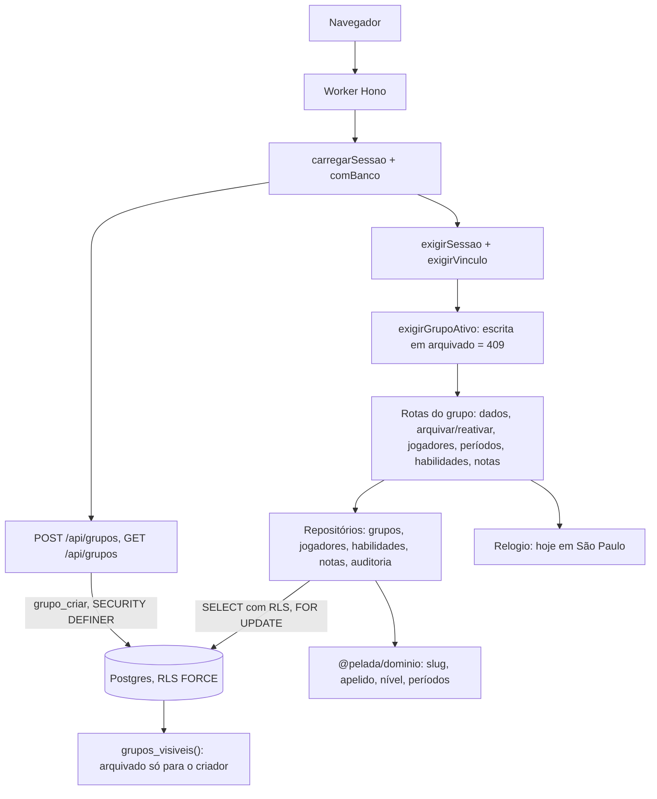

# Grupos e elenco — Desenho

**Spec**: `.specs/features/grupos-e-elenco/spec.md` (e `context.md`)
**Status**: Approved (usuário, 2026-10-29)
**Mockup**: a fazer (fase 7, `mockup-visual` em modo módulo): t08 com "Criar grupo" e "Arquivados", t27 sem
"Primeiro admin", t20 com a zona de arquivar da t28 só para quem criou, t16 sem as prévias e com o texto novo da
exclusão. As outras telas da feature (t09, t15, t17) já estão no mockup do projeto.
**Abordagem escolhida pelo usuário (2026-10-29)**: o grupo arquivado some para os outros admins **no banco**, pela
`grupos_visiveis()`, e não num filtro da aplicação. Alternativa recusada: o `exigirVinculo` ler `arquivado_em` e
`criado_por`, o que obrigaria cada consulta fora do middleware (sessão, listas, features seguintes) a lembrar do filtro.

Conforma com AD-001 a AD-013. Decisões novas de projeto: AD-014 e AD-015 (fim deste documento).

---

## Architecture Overview

A feature segue o desenho da `fundacao` e da `conta-e-acesso`: rota Hono fina, repositório Kysely que recebe o `Db` da
transação da requisição (ADR-025), RLS com `FORCE` por `grupo_id` e regras puras em `@pelada/dominio`. Os pontos
novos:

1. **Criar grupo por função do banco.** A policy de INSERT exige `id IN (grupos_visiveis())`, e um grupo que ainda não
   existe não tem vínculo; o `pelada_app` não consegue criá-lo. A função `grupo_criar` (`SECURITY DEFINER`, mesmo
   padrão do AD-008) cria grupo, vínculo, habilidades iniciais e auditoria de uma vez, e escolhe o sufixo livre do
   slug, com nova tentativa na colisão (GEL-14, GEL-15). Ela lê os slugs de todos os grupos, que a RLS esconde do
   `pelada_app`.
2. **Grupo arquivado escondido pela RLS.** Uma migration nova troca `grupos_visiveis()`: com conta, um grupo
   arquivado só é visível se a conta tem vínculo **e** é a criadora. Todas as policies, o `exigirVinculo` e as
   consultas das features seguintes passam a respeitar o arquivamento sem código novo (GEL-25). O ramo do slug público
   não muda; a página "Grupo indisponível" é da `partidas-e-ranking`.
3. **Escrita bloqueada no grupo arquivado.** O middleware `exigirGrupoAtivo`, depois do `exigirVinculo`, responde
   409 `grupo_arquivado` a todo método de escrita sob `/api/grupos/:grupoId/*`, exceto `POST …/reativar` (GEL-26).
   Vale também para as rotas de admins e convites que já existem.
4. **Relógio único da API.** O "hoje" de São Paulo vem de um `Relogio` injetado no contexto do Hono (cópia do legado),
   nunca de `now()` do SQL nem do domínio. Os testes fixam a data.
5. **Período sempre pelo repositório de jogadores, com trava.** Inativar, reativar, corrigir datas e alterar o início
   rodam na transação da requisição: `SELECT … FOR UPDATE` no jogador, leitura dos períodos e das presenças,
   `avaliarPeriodos` do domínio, escrita e auditoria (GEL-109, GEL-110). Uma checagem do repositório falha se outro
   arquivo escrever `periodos_ativos` ou `inicio_pontuacao` (GEL-83, GEL-111).



---

## Code Reuse Analysis

### Existing Components to Leverage

| Component | Location | How to Use |
| --- | --- | --- |
| Transação da requisição, `comBanco` | `backend/api/src/infraestrutura/db/transacao-da-requisicao.ts`, `entrada/middlewares/com-banco.ts:14-30` | Como estão. Escrita em transação de leitura e escrita; COMMIT só com status < 400, então um 422 desfaz tudo (GEL-09) |
| `exigirSessao`, `exigirVinculo` | `entrada/middlewares/sessao.ts:30-33`, `vinculo.ts:12-18` | Como estão; com a nova `grupos_visiveis()`, o vínculo já devolve 404 para o grupo arquivado de quem não criou |
| `lerCorpo` (422 com `campos`) | `entrada/corpo.ts:23-51` | Todas as rotas novas. Campo desconhecido cai no `strictObject` |
| Erros padrão | `entrada/erros.ts:4-68` | Códigos novos: `grupo_arquivado`, `so_quem_criou`, `jogador_com_historico`, `ja_inativo`, `ja_ativo` |
| `auditoria.registrar` | `infraestrutura/db/repositorios/auditoria.ts:9-30` | Todos os eventos da feature, exceto `grupo_criado` (gravado pela função) |
| Padrão de repositório | `infraestrutura/db/repositorios/admins.ts` | `grupoId` como primeiro parâmetro (checado por `backend/scripts/checagens/checar-grupo-id.mjs`) |
| Suíte e meta de isolamento | `backend/api/test/isolamento/casos.ts`, `meta.test.ts` | As tabelas já têm caso; as rotas novas entram em `CASOS_ROTAS` (GEL-106) |
| Apoio de teste | `test/apoio/{cliente,banco,como-role,cenario-dois-grupos,grupo-isolado}.ts` | Testes de rota com duas contas e dois grupos |
| Contrato e snapshot G-20 | `backend/contrato/src/{acesso,dias,limites,primitivos}.ts`, `compatibilidade.json` | `DIAS_DA_SEMANA` e `LIMITES` reaproveitados; arquivos novos `grupo.ts` e `elenco.ts` entram no snapshot |
| Lint do domínio | `eslint.config.mjs:41-52, 245-249` (`DOMINIO_PROIBIDAS`) | Já impede I/O, relógio e zod em `backend/dominio/**` (GEL-70, GEL-104) |
| Relógio do legado | LEG `backend/api/src/infraestrutura/relogio/index.ts` | Copiado como está |
| Domínio do legado | LEG `backend/dominio/src/grupos/slug.ts`, `elenco/{apelido,idade,nivel,habilidades-iniciais}.ts`, `atividade/{atividade,validar-periodos,avaliar-periodos,cobertura-periodos,periodos-corrigiveis}.ts` e testes em `backend/dominio/test/**` | Copiados. Os testes entram só com a ligação a um GEL no `tasks.md` (AD-002); `gerarSlug` (sufixo em memória) fica de fora, pois o sufixo é escolhido no banco |
| Contratos do legado | LEG `backend/contrato/src/grupo.ts`, `elenco.ts` | Copiados e passados a `z.strictObject`; a fábrica por `hoje` do ano de nascimento (`elenco.ts:111-122`) é mantida |
| Casos de uso do legado | LEG `backend/api/src/aplicacao/elenco/*.ts`, `repositorios/jogadores.ts` (trava em 247-257) | Viram funções do repositório e da rota; a camada `aplicacao/` não existe no app novo |
| Telas do legado | LEG `frontend/web/src/telas/{grupo,grupos,jogadores,jogador,habilidades,inicio}/`, `dados/{grupo,elenco,habilidades,notas}.ts` | Copiadas e adaptadas às rotas `/app/grupos/:grupoId/...`, sem prévias de acumulado (C7) e sem pesos (C6) |
| Componentes base | `frontend/web/src/componentes/{basicos,campos,listas,dialogos,escolhas}/` | `CampoNota`, `CampoData`, `CampoHora`, `CampoSeletor`, `EstadoVazio`, `Dialogo`, `ResumoErros`, `SeloSalvo` etc. |
| Comparação visual | `frontend/web/e2e/visual.mjs`, `e2e/telas-ativas.txt`, `.specs/mockup/telas.json` | Telas t08, t09, t15, t16, t17, t20, t27 e as do mockup do módulo entram em `telas-ativas.txt` |

### Integration Points

| System | Integration Method |
| --- | --- |
| Postgres | Uma migration aditiva `…_grupos-e-elenco.sql`: troca de `grupos_visiveis()`, `grupo_criar`, grants por coluna em `grupos`. Nenhuma tabela nova: a linha de base já tem `grupos`, `jogadores`, `periodos_ativos`, `habilidades`, `notas` com RLS |
| Sessão | `GET /api/sessao` passa a listar só grupos ativos (`repositorios/contas.ts:81-91` ganha `arquivado_em IS NULL`). A lista completa, com arquivados e a recorrência, vem de `GET /api/grupos` |
| Front | Rotas novas em `frontend/web/src/app/rotas.tsx`, todas sob a `RotaProtegida` |
| Comparação visual | `telas.json` usa `/admin/<slug>` e `/api/sessao/eu`; as entradas novas seguem o mapeamento que a `conta-e-acesso` já fez para t08 e t19 |

---

## Components

### C1. Migration da feature

- **Purpose**: visibilidade do arquivado, criação de grupo e grants mais estreitos, numa migration aditiva (G-14).
- **Location**: `backend/api/src/infraestrutura/db/migracoes/<timestamp>_grupos-e-elenco.sql`
- **Interfaces (SQL)**:
  - `CREATE OR REPLACE FUNCTION grupos_visiveis()`: o ramo da conta passa a ser `SELECT v.grupo_id FROM vinculos_admin v JOIN grupos g ON g.id = v.grupo_id WHERE v.conta_id = app_conta_id() AND (g.arquivado_em IS NULL OR g.criado_por = app_conta_id())`. O ramo do slug não muda. Mesmos `SECURITY DEFINER`, `search_path` e grants.
  - `grupo_criar(nome text, dia_semana text, frequencia text, horario time, slug_base text, habilidades text[])` (`SECURITY DEFINER`, `search_path` fixo, `EXECUTE` só para `pelada_app`): exige `app_conta_id()`; acha o primeiro sufixo livre entre `slug_base` e `slug_base-N` (N ≥ 2) contando grupos arquivados; insere grupo (`criado_por` = conta), vínculo (`acessa_financeiro` = true), as habilidades na ordem recebida e a auditoria `grupo_criado`; em `unique_violation` do slug, repete com o próximo sufixo, até 3 tentativas. Devolve `(id, slug)`. Tudo na transação da requisição: qualquer falha desfaz tudo (GEL-09).
  - Grants em `grupos`: `REVOKE UPDATE ON grupos FROM pelada_app` e `GRANT UPDATE (nome, dia_semana, frequencia, horario, arquivado_em)`. Tira do runtime a escrita de `criado_por`, `situacao_comercial` e `trial_inicio`; o slug já é imutável pela trigger da linha de base (GEL-16).
  - Sem tabela nova e sem mudança nas policies.
- **Dependencies**: `app_conta_id()`, `vinculos_admin`, `auditoria`.
- **Reuses**: o padrão de `convite_criar` (`…_conta-convites.sql:13`).

### C2. Domínio

- **Purpose**: as regras puras da feature, sem relógio e sem I/O (GEL-70, GEL-104).
- **Location**: `backend/dominio/src/{grupos,elenco,atividade}/`, `backend/dominio/src/index.ts`
- **Interfaces**:
  - `slugBase(nome: string): string`: GEL-11 a GEL-13.
  - `compararApelido(a, b): number`, `chaveBusca(texto): string` (sem acento e sem caixa, para ordenar e buscar; GEL-47, GEL-48).
  - `calcularNivel(notas: number[]): { nivel: number; semNota: boolean }`: GEL-101, GEL-102.
  - `HABILIDADES_INICIAIS`: GEL-02.
  - `anoNascimentoMaximo(hoje: string): number`: ano de hoje − 10 (GEL-36).
  - `avaliarPeriodos(entrada): { ok: true; periodos } | { ok: false; regra; mensagem; campo }`: as regras (a) a (h) na ordem do GEL-62, para inativar, reativar, corrigir e alterar o início (GEL-58, GEL-61 a GEL-69, GEL-72, GEL-73, GEL-78 a GEL-81), com `hoje` como parâmetro. Inclui `coberturaRetirada` (presença que sai de dentro de um período, GEL-68).
  - `formatarData(iso): string` (`dd/mm/aaaa`, para as mensagens).
- **Dependencies**: nenhuma.
- **Reuses**: o domínio do legado, com seus testes.

### C3. Relógio

- **Purpose**: o único lugar da API que lê a data (ADR-012).
- **Location**: `backend/api/src/infraestrutura/relogio/index.ts`; `AppEnv` ganha `relogio`; `criarApp(opcoes)` aceita `opcoes.relogio`.
- **Interfaces**: `Relogio.hoje(): string` (`AAAA-MM-DD` em São Paulo), `mes()`, `agoraIso()`.
- **Reuses**: cópia do legado.

### C4. Contrato

- **Purpose**: formas e limites compartilhados entre API e web (AD-009).
- **Location**: `backend/contrato/src/{grupo,elenco}.ts`
- **Interfaces**:
  - `dadosGrupo` (nome 3 a 60 com trim, `diaSemana`, `frequencia`, `horario` `HH:MM`), `criarGrupoCorpo` e `editarGrupoCorpo` (strict, recusam `slug` e `urlPublica`), `arquivarCorpo { nomeConfirmacao }`, `grupoDetalhe`, `gruposResposta { ativos, arquivados }`.
  - `jogadorCorpo(hoje)`: fábrica com `anoNascimento` até `anoNascimentoMaximo(hoje)`; `apelido`, `posicao`, `telefone` (máscara retirada, 11 dígitos), `pontuacaoInicial` (0 a 9999), `dataEntrada` opcional. `editarJogadorCorpo(hoje)` sem `dataEntrada`.
  - `dataCorpo { data? }` (inativar, reativar), `corrigirPeriodoCorpo { saida?, retorno? }`, `inicioCorpo { data }`, `habilidadeCorpo { nome }`, `notaCorpo { nota: 1..10 | null }`.
  - Respostas: `jogadorItem` (id, apelido, posição, situação, desde, nível, `semNota`), `jogadorDetalhe` (com períodos e notas), `habilidadeItem`.
  - As mensagens do GEL ficam nos schemas, como no legado. As regras de período ficam no domínio, não no zod.
- **Reuses**: `DIAS_DA_SEMANA`, `LIMITES`, contratos do legado.

### C5. Repositórios

- **Purpose**: a única porta da aplicação para as tabelas da feature (G-02, G-03).
- **Location**: `backend/api/src/infraestrutura/db/repositorios/{grupos,jogadores,habilidades,notas}.ts`; tipos em `infraestrutura/db/tipos.ts` (`grupos` completo, `jogadores`, `periodos_ativos`, `habilidades`, `notas`, `presencas` e `partidas` só leitura, `pagamentos_mes` só leitura).
- **Interfaces**:
  - `grupos.criar(db, dados, slugBase)` (chama `grupo_criar`), `grupos.listarDaConta(db)` (ativos e arquivados que a conta criou), `grupos.ler(db, grupoId)` (com contagens e `souCriador`), `grupos.editar(db, grupoId, dados)`, `grupos.arquivar(db, grupoId, nomeConfirmacao)` e `grupos.reativar(db, grupoId)`: travam a linha do grupo (`FOR UPDATE`), conferem `criado_por = app_conta_id()` (senão `so_quem_criou`) e o estado (idempotente, GEL-29), gravam e auditam.
  - `jogadores.listar(db, grupoId)` (uma consulta de jogadores e período aberto e uma de notas do grupo; o nível sai do domínio, sem N+1), `jogadores.ler(db, grupoId, id)`, `jogadores.criar(db, grupoId, dados, hoje)`, `jogadores.editar(db, grupoId, id, dados)`, `jogadores.excluir(db, grupoId, id)`.
  - Escritas de período, todas em `jogadores.ts` (GEL-109, GEL-111): `inativar`, `reativar`, `corrigirPeriodo`, `alterarInicio(db, grupoId, id, dados, hoje)`. Cada uma faz `SELECT … FROM jogadores WHERE id AND grupo_id FOR UPDATE`, lê os períodos e as presenças (`presencas` com `partidas.data`, situação presente, lesionado ou expulso), chama `avaliarPeriodos`, grava e audita. A segunda requisição concorrente espera a trava e é validada sobre o resultado da primeira (GEL-110).
  - `habilidades.listar | criar | renomear | excluir(db, grupoId, …)`: a ordem é a coluna `ordem` (identity da linha de base); excluir apaga as notas pela FK com cascade e audita `habilidade_excluida`.
  - `notas.salvar(db, grupoId, jogadorId, habilidadeId, nota | null)`: `INSERT … ON CONFLICT DO UPDATE` ou `DELETE`; devolve o nível recalculado.
  - Apelido e habilidade repetidos: consulta antes de gravar (422 com a mensagem do GEL); a corrida que passar cai no índice único (`jogadores_apelido_grupo`, `habilidades_nome_grupo`), e o erro 23505 com esse nome de constraint vira o mesmo 422.
- **Dependencies**: `Db`, `@pelada/dominio`, `auditoria.registrar`.
- **Reuses**: os repositórios do legado (`jogadores.ts:104-262`).

### C6. Middlewares e rotas

- **Purpose**: as rotas da spec, finas sobre os repositórios.
- **Location**: `backend/api/src/entrada/middlewares/grupo-ativo.ts`; `backend/api/src/entrada/rotas/{grupos,jogadores,periodos,habilidades,notas}.ts`
- **Interfaces (HTTP)**:

  | Rota | Resposta | GEL |
  | --- | --- | --- |
  | `POST /api/grupos` | 201 `{ id, slug, linkPublico }`; 401 sem sessão | 01 a 17 |
  | `GET /api/grupos` | 200 `{ ativos, arquivados }`, com dia, frequência e horário | 27 |
  | `GET /api/grupos/:grupoId` | 200 `grupoDetalhe` | 20, 21 |
  | `PATCH /api/grupos/:grupoId` | 200 `grupoDetalhe` | 18, 19 |
  | `POST /api/grupos/:grupoId/arquivar` | 200; 422 nome; 403 `so_quem_criou` | 22 a 25, 29 |
  | `POST /api/grupos/:grupoId/reativar` | 200; 403 `so_quem_criou` | 24, 28, 29 |
  | `GET` e `POST /api/grupos/:grupoId/jogadores` | 200 lista; 201 jogador | 31 a 40, 46, 50 |
  | `GET`, `PATCH` e `DELETE /api/grupos/:grupoId/jogadores/:id` | 200; 200; 204 ou 409 `jogador_com_historico` | 41 a 45, 84, 85 |
  | `POST …/jogadores/:id/inativar` e `…/reativar` | 200; 409 `ja_inativo` ou `ja_ativo`; 422 de período | 51 a 58 |
  | `PATCH …/jogadores/:id/periodos/:periodoId` | 200 (ou `alterado: false`) | 71 a 75 |
  | `PUT …/jogadores/:id/inicio` | 200 | 77 a 83 |
  | `GET`, `POST`, `PATCH` e `DELETE /api/grupos/:grupoId/habilidades[/:id]` | 200; 201; 200; 204 | 88 a 96 |
  | `PUT …/jogadores/:id/notas/:habilidadeId` | 200 `{ nivel, semNota }` | 97 a 100, 105 |

  - `exigirGrupoAtivo`: em método diferente de GET e HEAD, lê `arquivado_em` do grupo (visível, pois o vínculo passou); se arquivado e a rota não é `…/reativar`, 409 `grupo_arquivado`.
  - `linkPublico` = `<URL_PUBLICA>/g/<slug>` (GEL-17), de `c.env.URL_PUBLICA`.
  - A ordem das rotas específicas (`…/arquivar`, `…/reativar`) vem antes do `PATCH /:grupoId` só por clareza; o Hono casa por método.
- **Reuses**: as rotas do legado em `entrada/rotas/grupos/jogadores/`.

### C7. Checagens e testes transversais

- **Purpose**: provar as regras que nenhuma rota sozinha prova.
- **Location**: `backend/scripts/checagens/checar-escritores-periodo.mjs` e teste em `backend/scripts/checagens/test/`; casos em `backend/api/test/isolamento/casos.ts`; testes de rota em `backend/api/test/rotas/{grupos,jogadores,periodos,habilidades,notas}.test.ts`.
- **Interfaces**:
  - `checar-escritores-periodo`: falha se `periodos_ativos` (INSERT, UPDATE, DELETE, ou `insertInto`/`updateTable`/`deleteFrom` do Kysely) ou `inicio_pontuacao` aparecerem em escrita fora de `repositorios/jogadores.ts` e das migrations (GEL-83, GEL-111). Ligada ao `pnpm test:checagens`.
  - `CASOS_ROTAS`: `POST /api/grupos` e `GET /api/grupos` como `nao_se_aplica` (sem `:grupoId`; a função e a RLS decidem), as outras como `grupo` (GEL-106).
  - Teste de 404 cruzado por rota (grupo B, e jogador, período e habilidade de outro grupo; GEL-107, GEL-108), rodando como `pelada_app` (GEL-112).
  - Teste de concorrência de período com duas conexões (GEL-110) e de slug com duas criações simultâneas (GEL-15).
  - Teste da auditoria: o `resumo` dos eventos não tem telefone nem ano de nascimento (GEL-113).
- **Reuses**: `checar-grupo-id.mjs` como modelo de checagem; `cenario-dois-grupos.ts`.

### C8. Telas e dados do front

- **Purpose**: as telas da spec no visual do mockup (GEL-114 a GEL-118).
- **Location**: `frontend/web/src/dados/{grupos,elenco,habilidades,notas}.ts`; `frontend/web/src/telas/{grupos,novo-grupo,grupo,dados-grupo,jogadores,jogador,habilidades}/`
- **Rotas do app**: `/app` (t08, com "Criar grupo" e "Arquivados"), `/app/grupos/novo` (t27), `/app/grupos/:grupoId` (t09), `/app/grupos/:grupoId/dados` (t20 com arquivar), `/app/grupos/:grupoId/jogadores` (t15), `/app/grupos/:grupoId/jogadores/novo` e `/:jogadorId` (t16), `/app/grupos/:grupoId/habilidades` (t17).
- **Interfaces**: hooks TanStack Query (`useGrupos`, `useGrupo`, `useJogadores`, `useJogador`, `useHabilidades`) e mutações que invalidam a lista e a ficha; o `ResumoErros` mostra "Corrija N campos" a partir de `campos` (GEL-118).
- **Testes**: Testing Library com axe nas telas novas; comparação visual com as telas da lista do Integration Points.
- **Reuses**: telas e dados do legado; `SeusGrupos.tsx` passa a usar `GET /api/grupos` e mostra a recorrência (fecha o SPEC_DEVIATION do cabeçalho).

### C9. Seed

- **Purpose**: dados de exemplo para o `pnpm dev` e para a revisão manual.
- **Location**: `backend/api/src/infraestrutura/db/repositorios/seed-local.ts` e `backend/scripts/seed.ts`
- **Interfaces**: o seed cria o grupo de exemplo pela `grupo_criar` e jogadores com períodos e notas, para a lista, a ficha e um inativo.

---

## Data Models

Sem tabela nova. Colunas usadas (linha de base, `linha-de-base.sql`):

```typescript
interface Grupo {
  id: string; nome: string; slug: string; dia_semana: DiaSemana; frequencia: 'semanal' | 'quinzenal' | 'mensal';
  horario: string; arquivado_em: Date | null; criado_por: string; criado_em: Date
  situacao_comercial: string // padrão do banco, não tocado (C2)
}
interface Jogador {
  id: string; grupo_id: string; apelido: string; ano_nascimento: number | null; posicao: Posicao
  telefone: string | null; pontuacao_inicial: number; inicio_pontuacao: string // date
}
interface PeriodoAtivo { id: string; grupo_id: string; jogador_id: string; inicio: string; fim: string | null } // [inicio, fim)
interface Habilidade { id: string; grupo_id: string; nome: string; ordem: number }
interface Nota { grupo_id: string; jogador_id: string; habilidade_id: string; valor: number } // 1 a 10
```

**Relationships**: `periodos_ativos` → `jogadores` com cascade (excluir jogador apaga os períodos, GEL-84);
`notas` → `habilidades` com cascade (GEL-93) e → `jogadores` sem cascade; `presencas` e `pagamentos_mes` →
`jogadores` sem cascade (bloqueio de exclusão, C8). Ativo = período com `fim IS NULL` (GEL-50), garantido único por
`periodos_um_aberto`.

---

## Error Handling Strategy

| Error Scenario | Handling | User Impact |
| --- | --- | --- |
| Corpo inválido ou campo desconhecido | `lerCorpo`, 422 com `campos` | "Corrija N campos" e a mensagem ao lado do campo |
| Regra de período violada | `avaliarPeriodos` devolve a primeira falha; 422 com a mensagem no campo da data | Mensagem do GEL com a data `dd/mm/aaaa` |
| Apelido ou habilidade repetidos (inclusive em corrida) | Consulta prévia; 23505 com o nome da constraint vira o mesmo 422 | Mensagem de nome repetido no campo |
| Slug em colisão concorrente | `grupo_criar` tenta o próximo sufixo, até 3 vezes; depois, erro 500 | Raríssimo; "Tente de novo" |
| Grupo de outro, ou arquivado de quem não criou | RLS sem linha, 404 `nao_encontrado` | Tela de não encontrado |
| Escrita em grupo arquivado | `exigirGrupoAtivo`, 409 `grupo_arquivado` | Aviso de grupo arquivado |
| Arquivar ou reativar sem ser o criador | 403 `so_quem_criou` | A tela nem mostra a ação para quem não criou |
| Jogador já inativo ou já ativo | 409 `ja_inativo` ou `ja_ativo` | Mensagem do GEL-53 ou do GEL-56 |
| Exclusão com histórico | 409 `jogador_com_historico`, sugestão `inativar` | Mensagem e "Inativar em vez disso" |
| Erro inesperado no meio de uma escrita | Status ≥ 400 desfaz a transação; Sentry recebe | Nada fica pela metade |

---

## Risks & Concerns

| Concern | Location (file:line) | Impact | Mitigation |
| --- | --- | --- | --- |
| A RLS impede o `pelada_app` de criar grupo, e os testes criam como owner | `1792843320000_rls.sql:49`; `test/apoio/grupo-isolado.ts:25` | A rota passaria nos testes e falharia em produção | C1 `grupo_criar`; o teste de `POST /api/grupos` roda como `pelada_app` |
| `grupos_visiveis()` ignora `arquivado_em`, e a sessão lista arquivados | `1792843320000_rls.sql:17-27`; `repositorios/contas.ts:81-91` | Admin que não criou continuaria vendo o grupo arquivado | C1 troca a função; C5 filtra a sessão; teste de isolamento com grupo arquivado |
| Trocar `grupos_visiveis()` afeta todas as policies | migration C1 | Uma regressão vaza ou esconde dados em todas as tabelas | A suíte de isolamento inteira roda depois da troca; casos novos: arquivado visível ao criador, invisível ao outro admin, slug público inalterado |
| UPDATE de `grupos` liberado em todas as colunas | `1792843260000_roles.sql:22` | Um bug poderia trocar `criado_por` (quem arquiva) | Grant por coluna em C1, com teste |
| Unicidade sem tratamento: 23505 vira 500 | `linha-de-base.sql:68, 120, 141` | Corrida de apelido ou habilidade responde 500 | C5 traduz pelo nome da constraint; teste com dois INSERTs |
| Sem relógio injetado | `repositorios/admins.ts:25` usa `now()` | Data errada perto da meia-noite UTC | C3; regras de data só com `relogio.hoje()`; teste com data fixa às 22h de São Paulo |
| Banco não impede sobreposição nem ordem de períodos | `linha-de-base.sql:128, 131` | Escrita fora do repositório bagunça o ranking | Trava e domínio em C5; checagem C7 (GEL-111) |
| Domínio do novo vazio; `situacao-rodada.ts` e `validarPeriodos` do legado com pouca cobertura | LEG `backend/dominio/src/atividade/situacao-rodada.ts:9` | Regras portadas sem prova | Só entram as funções usadas aqui; cada regra (a) a (h) com teste ligado ao GEL; `situacao-rodada` fica para a `partidas-e-ranking` |
| Arquivar enquanto o criador é removido | `repositorios/admins.ts:47` trava `vinculos_admin` | Criador já removido arquiva | `arquivar` lê o vínculo da própria conta com `FOR KEY SHARE` na mesma transação; sem vínculo, 404 |
| Mockup com rotas e respostas simuladas diferentes das do app | `.specs/mockup/telas.json` | A comparação visual falha sem ajuste | Mesmo mapeamento já usado para t08 e t19; telas novas no mockup do módulo |
| `meta.test.ts` só confere a lista, não o 404 de cada rota | `test/isolamento/meta.test.ts` | Rota nova sem prova de isolamento | Teste de 404 cruzado por rota (C7) |

---

## Tech Decisions

| Decision | Choice | Rationale |
| --- | --- | --- |
| Sufixo do slug | No banco, dentro de `grupo_criar` | Só o banco vê os slugs de todos os grupos, e a nova tentativa precisa de subtransação (bloco `EXCEPTION`), que a transação da requisição não permite (ela recusa comandos de controle). A base do slug fica no domínio |
| Camada de aplicação | Não criar `aplicacao/`; rotas finas sobre repositórios | É o padrão do app novo desde a `conta-e-acesso` |
| Lista de grupos | `GET /api/grupos` novo; `GET /api/sessao` só com ativos | A sessão alimenta a guarda e não deve levar a quem não criou grupo arquivado; a lista precisa da recorrência |
| Nível na lista | Duas consultas e cálculo no domínio | Evita N+1 e mantém a regra num só lugar |
| `jogador_criado` e notas na auditoria | `jogador_criado` sim (GEL-45); nota não | A spec pede `jogador_criado`; salvar nota não tem evento na spec nem no legado |

## Decisões de projeto (registradas em `.specs/STATE.md` em 2026-10-29)

- **AD-014**: a visibilidade do grupo arquivado é decidida no banco: `grupos_visiveis()` só devolve um grupo arquivado
  à conta que tem vínculo e é a criadora. Toda feature seguinte herda o filtro sem código; escrita no arquivado é
  barrada pelo `exigirGrupoAtivo`. Vira o ADR-035.
- **AD-015**: a API lê a data só pelo `Relogio` injetado no contexto do Hono (`hoje()` em São Paulo); o SQL não usa
  `now()` nem `current_date` para regra de data, e o domínio recebe `hoje` como parâmetro.

---

## Spec

Requisitos GEL-01 a GEL-118 cobertos pelos componentes acima; a rastreabilidade fica na tabela da spec, preenchida no
`tasks.md`.
