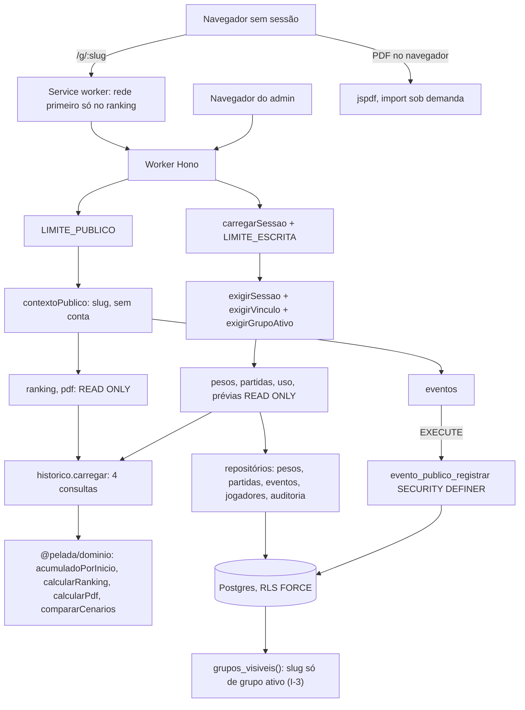

# Partidas e ranking — Desenho

**Spec**: `.specs/features/partidas-e-ranking/spec.md` (PAR-01 a PAR-161) e `context.md` (P1 a P12)
**Status**: Approved (usuário, 2026-10-30); mockup do módulo a seguir
**Mockup**: a fazer no modo módulo, em `.specs/features/partidas-e-ranking/mockup/` (ver "Mockup do módulo").

Conforma com AD-001 a AD-015. Decisões do usuário nesta fase (2026-10-30): eventos públicos por função
`SECURITY DEFINER` (D1) e cálculo no domínio puro, na leitura (D2). Também (D3 a D6): o `grupo_criar` antigo delega ao novo
(AD-019); data da partida e vigência dos pesos imutáveis no banco por grant de coluna; ranking sem conexão em dois
lugares, como o legado (cache do SW e cópia no aparelho); a prévia de reativar usa o corpo `{ data }` da gravação.
Aceitos pelo usuário como propostos: `eventos_uso` lida só com conta, prévias em `READ ONLY` pelo sufixo `/previa`,
`partida_lancada` pela RLS com conta e medição de CPU por bench no CI e painel após o deploy (PREMISSA). Decisões novas de projeto: AD-016 a
AD-020 (fim deste documento), gravadas no `STATE.md`; ADR-036. Legado (LEG) = `C:\Leandro\Projetos\GestaoDaPelada`.

---

## Architecture Overview

Mesmo desenho das features anteriores: rota Hono fina, repositório Kysely sobre o `Db` da transação da requisição
(ADR-025), RLS com `FORCE` por `grupo_id` e regras puras em `@pelada/dominio`. O legado não tinha RLS (ADR-005):
tudo o que ele lia com `WHERE grupo_id` passa aqui a ler também pela policy, e o que ele escrevia sem conta (evento
público) passa por função do banco. Os pontos novos:

1. **Contexto público.** Um middleware `contextoPublico` em `/api/publico/:slug/*` valida o slug, põe
   `slugPublico` e **apaga** `contaId` antes da primeira consulta (o `comBanco` lê o contexto só nela). Sem isso,
   um admin logado que abre o ranking de outro grupo cairia no ramo com conta de `grupos_visiveis()` (FUN-13) e
   receberia 404. Slug malformado, inexistente ou de grupo arquivado: o mesmo 404 (PAR-90).
2. **Histórico do grupo e domínio na leitura (D2, ADR-006).** Um carregador único lê jogadores com períodos,
   partidas até hoje, presenças e pesos em 4 consultas, e o domínio calcula ranking, PDF e prévias pela função
   única `acumuladoPorInicio` (G-25). Nada de pontos gravados.
3. **Prévias em transação somente leitura.** São POST (corpo validado como na gravação), mas o `comBanco` abre
   `READ ONLY` quando o caminho termina em `/previa`; o `exigirGrupoAtivo` continua devolvendo 409 no arquivado (P12),
   lendo `arquivado_em` sem trava (o Postgres recusa `FOR KEY SHARE` em transação de leitura).
4. **Evento público pela função `evento_publico_registrar` (D1).** O contexto do slug continua sem escrita pela RLS
   (AD-004); o `pelada_app` só tem `EXECUTE` na função, que acha o grupo ativo e insere uma linha em `eventos_uso`.
5. **Travas.** Ordem única: grupo (`FOR KEY SHARE`, já no `exigirGrupoAtivo`) → partida (`FOR UPDATE`, na edição e
   na exclusão) → jogadores marcados em ordem crescente de id (`FOR UPDATE`, numa consulta). A correção de período
   trava o mesmo jogador (GEL-109), então lançar ou editar uma partida e corrigir o período dele se serializam (G-26).



---

## Code Reuse Analysis

### Existing Components to Leverage

| Component | Location | How to Use |
| --- | --- | --- |
| `comBanco` e transação da requisição | `entrada/middlewares/com-banco.ts:14-30`, `infraestrutura/db/transacao-da-requisicao.ts` | `somenteLeitura` passa a valer também para `…/previa`; resto igual (COMMIT só com status < 400) |
| `exigirSessao`, `exigirVinculo`, `exigirGrupoAtivo` | `entrada/middlewares/{sessao,vinculo,grupo-ativo}.ts` | Como estão; o `exigirGrupoAtivo` lê sem `forKeyShare()` quando a transação é de leitura (prévias) |
| Limites de taxa | `entrada/app.ts:118-121`, `middlewares/limite-taxa.ts` | `LIMITE_PUBLICO` (60/60 s por IP) já ligado em `/api/publico/*` (PAR-78); escritas do admin no `LIMITE_ESCRITA` |
| `semCache` | `middlewares/cache.ts` | Fica: `no-store` em toda `/api`, inclusive o ranking público. O cache é só o do service worker |
| `lerCorpo`, erros | `entrada/corpo.ts:23-51`, `entrada/erros.ts` | Todas as rotas; códigos novos `partida_ja_existe`; `corpoErro` ganha campo extra opcional (`dataExistente`) |
| Repositório de jogadores | `repositorios/jogadores.ts:249-257` (`travar`), `:397-420` (`travarParaPeriodo`), `:433-595` (escritas de período) | Ganha `travarVarios`, `ativosNaData`, leitura sem trava para as prévias e o resumo de acumulado na auditoria (PAR-122) |
| `auditoria.registrar` | `repositorios/auditoria.ts:9-30` | Eventos `pesos_configurados`, `pesos_substituidos`, `partida_lancada`, `partida_editada`, `partida_excluida` |
| Relógio | `infraestrutura/relogio/index.ts` | `hoje()`, `mes()`, `agoraIso()` em toda regra de data e no momento do evento (PAR-127) |
| Domínio atual | `backend/dominio/src/{datas.ts,atividade/*}` | `ativoEm`, `avaliarPeriodos`, `avaliarInicio` (GEL-81), `compararApelido`, `formatarData` |
| Checagens | `backend/scripts/checagens/{checar-escritores-periodo,checar-grupo-id,checar-migracao-aditiva}.mjs` | Valem sem mudança para o código novo |
| Lint G-26 | `eslint/plugin-pelada.mjs:83-126` (`sem-escrita-periodo`, escrita e não ligada) | Ligada em `eslint.config.mjs` (I-1, C9) |
| Isolamento | `test/isolamento/{casos,meta.test}.ts`, `test/apoio/cenario-dois-grupos.ts` | Rotas novas em `CASOS_ROTAS`; tipo novo `publico`; `eventos_uso` muda de `sem-grant` para só leitura e inserção |
| Web | `frontend/web/src/{dados/cliente.ts,dados/errosDeCampos.ts,componentes/*,pwa/AvisoInstalacao.tsx,sw.ts}` | Cliente com `X-Pelada`, `ResumoErros` (PAR-147), aviso de instalação, shell do SW |
| Comparação visual | `frontend/web/e2e/{visual.mjs,telas-ativas.txt}`, `.specs/mockup/telas.json` | Entradas `real` novas, lista `ocultar`, bloco `pdf` já existente para P01 |

**Do legado, por componente (AD-002)** — o que muda em todos: sem `aplicacao/` (as funções viram rota + repositório),
`ExecutorDb`/`Tx` viram o `Db` da requisição, e sem `enderecoNovo` (Out of Scope).

| Legado | Destino | Adaptação |
| --- | --- | --- |
| `dominio/src/pontuacao/*`, `ranking/*`, `pdf/*`, `datas/{datas,dia-de-jogo}.ts`, `atividade/situacao-rodada.ts` | `backend/dominio/src/{pontuacao,ranking,pdf}/`, `datas.ts` | Cópia; `datas.ts` novo recebe `mesDe`, `primeiroDia`, `ultimoDia`, `mesAnterior`, `mesSeguinte`, `compararMeses`, `diaDaSemana`; `anoNascimento` nulo vira 9999 no adaptador |
| `dominio/test/{pontuacao,ranking,pdf,datas}/*.test.ts` (inclui `regressao-todos`, Vandré, Kim, "saiu e voltou") | `backend/dominio/test/` | Entram com a ligação a um PAR no `tasks.md` |
| `api/aplicacao/pontuacao/{historico,adaptadores}.ts` | `repositorios/historico.ts` | Mesmas 4 consultas, agora sob RLS (do admin ou do slug); `pesosAte` mantido |
| `api/aplicacao/partidas/*`, `repositorios/partidas.ts` | `repositorios/partidas.ts`, `rotas/partidas.ts` | `travarMarcados` (uma ida por jogador) vira `jogadores.travarVarios` (uma consulta); 23505 de `UNIQUE (grupo_id, data)` vira 409 |
| `aplicacao/pesos/*`, `repositorios/pesos.ts` | `repositorios/pesos.ts`, `rotas/pesos.ts` | `registradoPor` com o nome pela função `contas_nomes_do_grupo` (a RLS de `contas` só mostra a própria) |
| `aplicacao/publico/*`, `rotas/publico/*` | `rotas/publico.ts` | `buscarGrupoPublico` vira leitura de `grupos` pela RLS do slug; evento pela função (D1) |
| `repositorios/eventos.ts` (`porSemana`, `aparelhosDaSemana`) | `repositorios/eventos.ts` | SQL igual; o `registrar` do público sai (vai para a função); `partida_lancada` por INSERT com conta |
| `rotas/grupos/jogadores/{reativar-previa,periodos-previa,inicio}.ts`, `aplicacao/elenco/*-previa.ts` | `rotas/periodos.ts` | Mesmas regras; transação `READ ONLY` |
| `contrato/src/{partidas,pesos,publico,pdf,uso,elenco-periodos}.ts` | `backend/contrato/src/` | `z.strictObject` em tudo; sem `enderecoNovo`; snapshot G-20 |
| Web: `telas/{ranking,partidas,partida,pontuacao,grupo-indisponivel,uso}`, `componentes/{tabela-ranking,previa-periodos,seletor-situacao}`, `pdf/*`, `dados/{publico,partida,partidas-mes,pesos,uso,eventos,periodos,useMesDaUrl}`, `pwa/armazenamento/*`, `pwa/regras-sw.ts` e o trecho de ranking do `pwa/sw.ts`, `e2e/{ranking-offline,pdf-visual}.spec.ts` | Mesmos nomes em `frontend/web/src/` | Rotas `/app/grupos/:grupoId/...`; sem `grupoLembrado`/`lembrarGrupo` e sem a faixa de endereço novo; sem o aviso "Pré-marcado pela escalação" (RF-26) |

### Integration Points

| System | Integration Method |
| --- | --- |
| Postgres | Migrations aditivas novas (C1); nenhuma tabela nova: `config_pesos`, `partidas`, `presencas` e `eventos_uso` já estão na linha de base com RLS |
| Sessão e início do grupo | `GET /api/grupos/:grupoId` (`rotas/grupos.ts`) ganha os campos de PAR-132 |
| Elenco | Escritas de período (`rotas/periodos.ts`) ganham as prévias e o resumo de acumulado na auditoria |
| Seed | `seed-local.ts` passa a chamar `grupo_criar` com a data e grava partidas e presenças do exemplo da t01 |
| Front | Rotas novas em `app/rotas.tsx`; `/g/:slug` fora da `RotaProtegida` |

---

## Components

### C1. Migrations

- **Purpose**: pesos padrão, `grupo_criar` com pesos, evento público, grants mínimos e o I-3, todas aditivas (G-14).
- **Location**: `backend/api/src/infraestrutura/db/migracoes/<timestamp>_*.sql`, uma por item, na ordem abaixo.
- **Interfaces (SQL)**:
  1. `…_pesos-padrao.sql` (PAR-13, PAR-14): `INSERT INTO config_pesos (grupo_id, vigente_desde, presenca_sem_chuva,
     presenca_com_chuva, lesionado_sem_chuva, lesionado_com_chuva, expulso, expulso_com_chuva, registrado_por,
     registrado_em) SELECT g.id, (g.criado_em AT TIME ZONE 'America/Sao_Paulo')::date, 1, 1, 1, 1, -1, -1,
     g.criado_por, g.criado_em FROM grupos g WHERE NOT EXISTS (SELECT 1 FROM config_pesos c WHERE c.grupo_id = g.id)`.
     Converte um momento gravado, não lê o relógio (AD-015). Roda como owner; idempotente.
  2. `…_grupo-criar-pesos.sql` (PAR-15, PAR-16): `CREATE FUNCTION grupo_criar(…, p_habilidades text[], p_hoje date)`
     (7 parâmetros), o corpo atual mais `INSERT INTO config_pesos (…) VALUES (v_id, p_hoje, 1, 1, 1, 1, -1, -1, v_conta,
     now())`; `p_hoje` nulo levanta erro. A de 6 parâmetros recebe `CREATE OR REPLACE` delegando à nova com
     `(now() AT TIME ZONE 'America/Sao_Paulo')::date`, só para o Worker anterior durante o deploy e o rollback do
     `deploy.yml` (exceção temporária ao AD-015, AD-019); sai numa migration `-- contrair:` da feature seguinte.
  3. `…_eventos-uso.sql` (PAR-127 a PAR-131): `evento_publico_registrar(p_slug text, p_tipo text, p_dispositivo uuid,
     p_mes text, p_momento timestamptz) RETURNS boolean`, `LANGUAGE plpgsql SECURITY DEFINER SET search_path = public,
     pg_temp`: exige `app_conta_id() IS NULL` e `p_slug = app_slug_publico()`; aceita só `ranking_aberto` (com
     dispositivo, sem mês) e `pdf_exportado` (com mês, sem dispositivo); acha `grupos WHERE slug = p_slug AND
     arquivado_em IS NULL`; sem grupo, `false`; senão insere a linha e devolve `true`. `REVOKE ALL … FROM PUBLIC`,
     `GRANT EXECUTE … TO pelada_app`. `GRANT SELECT, INSERT ON eventos_uso TO pelada_app` (sem UPDATE, DELETE e
     TRUNCATE) e `ALTER POLICY eventos_uso_ler ON eventos_uso USING (app_conta_id() IS NOT NULL AND grupo_id IN (SELECT
     grupos_visiveis()))`: o contexto do slug não lê eventos (o `dispositivo_id` não sai para o público).
  4. `…_contas-nomes-do-grupo.sql` (PAR-01, PAR-44, PAR-52): `contas_nomes_do_grupo(p_grupo_id uuid) RETURNS TABLE (id
     uuid, nome text)`, `SECURITY DEFINER`, padrão do `admins_listar`: só com conta e vínculo no grupo, e só as contas
     que aparecem em `config_pesos.registrado_por` ou `partidas.{criada_por,alterada_por}` daquele grupo. Nunca e-mail.
  5. `…_grants-partidas-pesos.sql` (P4, PAR-09): `REVOKE UPDATE ON partidas, config_pesos FROM pelada_app`; `GRANT
     UPDATE (choveu, alterada_por, alterada_em) ON partidas` e `GRANT UPDATE (presenca_sem_chuva, …, expulso_com_chuva,
     registrado_por, registrado_em) ON config_pesos`. A data da partida e a vigência ficam imutáveis no banco.
  6. `…_grupos-visiveis-publico-ativo.sql` (I-3, PAR-91): `CREATE OR REPLACE FUNCTION grupos_visiveis()` igual à de
     `1792844280000`, com `AND g.arquivado_em IS NULL` no ramo do slug. Mesmo `SECURITY DEFINER`, `search_path`, grants.
  - Auditorias novas não pedem migration: `acao` é texto livre e a policy de INSERT de `auditoria` já vale.
- **Dependencies**: `app_conta_id()`, `app_slug_publico()`, `grupos_visiveis()`.
- **Reuses**: `grupo_criar` e `admins_listar` atuais; `convite_criar` como modelo de função.

### C2. Domínio

- **Purpose**: todas as contas de pontos, sem relógio nem I/O (G-05, PAR-61).
- **Location**: `backend/dominio/src/{pontuacao,ranking,pdf}/`, `datas.ts`, `atividade/situacao-rodada.ts`, `index.ts`.
- **Interfaces** (cópia do LEG, nomes mantidos):
  - **Função única (G-25):** `acumuladoPorInicio(e: { inicio?: Data; pontuacaoInicial: number; presencas:
    readonly PresencaDoJogador[]; configs: readonly ConfigPesos[] | ResolvedorDePesos; referencia: Data; periodos?:
    readonly { inicio: Data }[]; periodoEm?: Data }): number` (PAR-57 a PAR-60). Usa `inicioDoPeriodo` e as internas
    `acumuladoAte` e `acumuladoComInicial`, que só o módulo `pontuacao` chama (regra de lint, C9).
  - `pontosDaPresenca(situacao, choveu, pesos)`, `criarResolvedorDePesos(configs)` (busca binária; anterior à
    primeira, a mais antiga; PAR-55, PAR-56), `PESOS_PADRAO`, `ehPesosPadrao(configs): boolean` (novo, P10, PAR-135).
  - `calcularRanking(e: EntradaRanking): ResultadoRanking` (PAR-67 a PAR-75, PAR-84 a PAR-87), com `ordenarPorRanking`
    (PAR-68, PAR-69), `rodadasDoJogador` (PAR-71 a PAR-73), `limitesDeMes`, `navegacaoDeMes`, `mesNoHistorico` (sai da
    `aplicacao/publico` do LEG para o domínio; PAR-66).
  - `calcularPdf(e: EntradaRanking): ProjecaoPdf` com `escolherColunasPdf` (12 mais recentes, PAR-96 a PAR-99).
  - Prévias: `compararCenarios` (reativar e corrigir, PAR-109, PAR-110, PAR-113, PAR-114), `previaDosPeriodos`
    (rodadas que passam e deixam de constar e `aviso`, PAR-116), `previaDoInicio` (PAR-111, PAR-115).
  - `dataSugeridaPartida(hoje, diaSemana)` (PAR-17), `validarMarcacoes(ativos, marcacoes)` (repetido, inativo;
    PAR-24, PAR-25; sai da `aplicacao/partidas/presencas.ts` do LEG) e `contagemDaPartida(presencas)`.
- **Testes**: os do LEG listados em Code Reuse; mais `desempenho.test.ts`: 40 jogadores × 104 partidas, mediana de
  `calcularRanking` < 5 ms em 50 rodadas (PAR-63), e o mesmo orçamento para `calcularPdf` e `compararCenarios`.
- **Dependencies**: nenhuma.

### C3. Contrato

- **Purpose**: formas compartilhadas com o web (AD-009), todas `z.strictObject`.
- **Location**: `backend/contrato/src/{pesos,partidas,publico,pdf,uso,previas}.ts`; `compatibilidade.json` (G-20).
- **Interfaces**: `pesosCorpo` (6 inteiros −10 a 10, "Use um número inteiro de -10 a 10."), `pesosPainel`;
  `partidaCorpo { data, choveu, marcacoes: { jogadorId: uuid, situacao }[] }`, `partidaResposta`, `partidaNova`,
  `partidasDoMes`, `consultaData`, `consultaMes`; `rankingPublico` e `pdfPublico` (só os campos de PAR-64, PAR-70 e
  PAR-95; `rodadas` com `situacao` e `pontos`), `eventoPublicoCorpo` (união discriminada por `tipo`, PAR-128),
  `usoResposta`; a prévia de reativar usa o mesmo `dataCorpo { data }` da gravação (PAR-109, decisão do usuário em 2026-10-30), `previaResposta`, `previaInicioResposta`.
  `grupoDetalhe` ganha os campos de PAR-132. `CAMPOS_PROIBIDOS_PUBLICO` exportado para o teste de G-10 (PAR-76).

### C4. Repositórios

- **Purpose**: a única porta da aplicação para as tabelas (G-02), com `grupoId` primeiro (`checar-grupo-id`).
- **Location**: `infraestrutura/db/repositorios/{historico,pesos,partidas,eventos,jogadores,grupos}.ts`; `tipos.ts`
  com `config_pesos`, `partidas`, `presencas` graváveis e `eventos_uso` só inserção.
- **Interfaces**:
  - `historico.carregar(db, grupoId, ate): HistoricoDoGrupo`: jogadores (só `id`, `apelido`, `ano_nascimento`,
    `pontuacao_inicial`, `inicio_pontuacao`, nunca telefone nem posição), períodos, partidas até `ate`, presenças e pesos
    (`pesosAte`). Serve ao público e ao admin; a RLS decide o que se vê.
  - `pesos.painel(db, grupoId, hoje)`, `pesos.salvar(db, grupoId, pesos, hoje): { substituiu }`: `INSERT … ON
    CONFLICT (grupo_id, vigente_desde) DO UPDATE` só para `vigente_desde = hoje` e auditoria (PAR-03 a PAR-05, PAR-09).
  - `partidas.doMes(db, grupoId, mes)`, `partidas.ler(db, grupoId, data)` (ativos na data mais quem tem presença,
    PAR-44), `partidas.lancar(db, grupoId, dados, hoje)`, `partidas.editar(db, grupoId, data, dados, hoje)`,
    `partidas.excluir(db, grupoId, data)`, `partidas.mesDaPrimeira(db, grupoId)`.
    - Lançar: `jogadores.travarVarios(ids)` (`SELECT id … WHERE grupo_id AND id = ANY ORDER BY id FOR UPDATE`, PAR-29)
      → `jogadores.ativosNaData` → `validarMarcacoes` → INSERT da partida (23505 em `partidas_grupo_id_data_key` vira
      `partida_ja_existe`, PAR-30) → presenças só de presente, lesionado, expulso (PAR-23) → `eventos.partidaLancada` →
      auditoria com contagens (PAR-28, PAR-142).
    - Editar: partida `FOR UPDATE` → `travarVarios` → validação na data da partida (PAR-48) → `UPDATE` de chuva e
      autoria, `DELETE` e `INSERT` das presenças → `partida_editada` (PAR-49). Excluir: `FOR UPDATE`, `DELETE` (cascade
      das presenças), `partida_excluida`; o evento fica (PAR-50, PAR-51).
  - `eventos.partidaLancada(db, grupoId, data, momento)` (INSERT com conta, pela RLS), `eventos.registrarPublico(db,
    slug, evento, momento)` (chama a função), `eventos.porSemana(db, grupoId)`, `eventos.aparelhosDaSemana(db, grupoId,
    hoje)` (PAR-155 a PAR-158).
  - `jogadores.ts` ganha `travarVarios`, `ativosNaData(db, grupoId, data)` (leitura, sem escrita de período) e
    `lerParaPrevia` (mesma leitura do `travarParaPeriodo`, sem trava). As escritas de período, depois do
    `avaliarPeriodos`, leem `historico.carregar` na mesma transação e gravam na auditoria `acumuladoAntes`,
    `acumuladoDepois`, `posicaoAntes` e `posicaoDepois` de `compararCenarios` (PAR-122).
  - `grupos.criar(db, dados, slugBase, hoje)` chama `grupo_criar` de 7 parâmetros; `grupos.ler` ganha os dados do
    início (PAR-132) a partir de `historico` mínimo (partidas do mês, pesos) e `eventos.aparelhosDaSemana`.
- **Reuses**: repositórios do LEG; padrão de trava de `jogadores.ts:249`.

### C5. Middlewares e rotas

- **Location**: `entrada/middlewares/{contexto-publico,com-banco,grupo-ativo}.ts`; `entrada/rotas/{pesos,partidas,
  publico,uso,periodos,grupos}.ts`; registro em `entrada/app.ts`.
- **`contextoPublico`** (`/api/publico/:slug/*`, depois de `carregarSessao`): slug fora de `^[a-z0-9-]{1,64}$` → 404
  sem consulta; senão `c.set('contaId', undefined)`, `c.set('slugPublico', slug)`. A rota lê o grupo por `grupos WHERE
  slug` (a RLS só mostra o do slug, ativo); sem linha → `naoEncontrado` (mesmo corpo para as três causas, PAR-90).
- **Rotas** (todas as de admin sob `exigirSessao`, `exigirVinculo`, `exigirGrupoAtivo`; Tx = transação):

| Método e caminho | Quem | Contrato | Tx | PAR |
| --- | --- | --- | --- | --- |
| `GET /api/grupos/:grupoId/pesos` | admin | resp. `pesosPainel` | RO | 01, 02 |
| `POST /api/grupos/:grupoId/pesos` | admin | `pesosCorpo` | RW | 03 a 09 |
| `GET /api/grupos/:grupoId/partidas?mes=` | admin | `consultaMes`; resp. `partidasDoMes` | RO | 37 a 41 |
| `GET /api/grupos/:grupoId/partidas/nova?data=` | admin | `consultaData`; resp. `partidaNova` | RO | 17 a 21 |
| `POST /api/grupos/:grupoId/partidas` | admin | `partidaCorpo`; 201 `partidaResposta` | RW | 19 a 30 |
| `GET /api/grupos/:grupoId/partidas/:data` | admin | resp. `partidaResposta` | RO | 44, 45 |
| `PUT /api/grupos/:grupoId/partidas/:data` | admin | `partidaCorpo` | RW | 45 a 49 |
| `DELETE /api/grupos/:grupoId/partidas/:data` | admin | 204 | RW | 45, 50, 51 |
| `GET /api/grupos/:grupoId/uso` | admin | resp. `usoResposta` | RO | 155 a 158 |
| `GET /api/grupos/:grupoId` (muda) | admin | `grupoDetalhe` ampliado | RO | 132 |
| `POST …/jogadores/:id/reativar/previa` | admin | `reativarPreviaCorpo`; resp. `previaResposta` | RO | 109, 112 a 116 |
| `POST …/jogadores/:id/periodos/:periodoId/previa` | admin | `corrigirPeriodoCorpo`; `previaResposta` | RO | 110, 112 a 116 |
| `POST …/jogadores/:id/inicio/previa` | admin | `inicioCorpo`; `previaInicioResposta` | RO | 111, 112, 115 |
| `GET /api/publico/:slug/ranking?mes=` | público | `consultaMes`; resp. `rankingPublico` | RO | 64 a 78, 84 a 87, 90 |
| `GET /api/publico/:slug/pdf?mes=` | público | resp. `pdfPublico` | RO | 95 a 101 |
| `POST /api/publico/:slug/eventos` | público | `eventoPublicoCorpo`, até 1 KB; 204 | RW (só a função) | 127 a 131 |

  - `/partidas/nova` é registrada antes de `/partidas/:data`; `:data` que não é data real → 404 (PAR-45).
  - Data futura e mês futuro comparam com `relogio.hoje()`/`mes()`; `geradoEm` = `relogio.agoraIso()`.
  - `urlPublica` do PDF = `<URL_PUBLICA>/g/<slug>` (sem URL absoluta no código).
  - Eventos: `bodyLimit` de `LIMITES.corpoPublicoBytes` na própria rota (413, PAR-128); função devolve `false` → 404.
  - Prévias: `comBanco` com `somenteLeitura` quando o caminho casa `/previa$`; a rota chama `lerParaPrevia`,
    `avaliarPeriodos` (mesma recusa da gravação, PAR-112), `historico.carregar` e o domínio. Nada é gravado.
- **`CASOS_ROTAS`**: as de admin como `grupo`; tipo novo `{ tipo: 'publico' }` para as três públicas, com teste de slug
  de outro grupo e de grupo arquivado (PAR-137 a PAR-139); `meta.test.ts` passa a aceitar o tipo.

### C6. Web: telas e dados

- **Rotas** (`app/rotas.tsx`, PAR-143): `/g/:slug` (t01, t03; fora da `RotaProtegida`), `/app/grupos/:grupoId/partidas`
  (t10), `…/partidas/nova` e `…/partidas/:data` (t11), `…/pontuacao` (t18), `…/uso` (t21).
- **Telas**: cópias do LEG (`PaginaRanking`, `TelaRanking`, `TabelaRanking`, `GrupoIndisponivel`, `PaginaPartidas`,
  `PaginaNovaPartida`, `PaginaEditarPartida`, `PaginaPontuacao`, `PaginaUso`). Slug malformado mostra a t03 sem chamar
  a API (PAR-94). Ranking: `?mes=` pela URL (`useMesDaUrl`), botões desabilitados com navegação nula (PAR-89).
- **t09** (`InicioDoGrupo.tsx`): Dia de jogo (lançar/editar na data sugerida), itens Partidas, Pontuação ("Pesos
  padrão" ou "Vigente desde", P10) e Uso do app; sem Simulador e Financeiro, que não são renderizados (P9, PAR-160);
  o `SPEC_DEVIATION` do cabeçalho do arquivo é retirado. **t01**: sem o atalho Financeiro (PAR-161).
- **t16** (`PeriodosJogador.tsx`, `CorrigirDatas.tsx`): `PreviaPeriodos` do LEG nos diálogos de reativar, corrigir e
  início, com "Calculando…" e "Confirmar" desabilitado até a prévia (PAR-117 a PAR-121); texto novo do reativar (P6,
  PAR-159). O teste `PeriodosJogador.test.tsx:136` muda com o motivo no teste e no commit (aprovado no `context.md`).
- **Dados**: `dados/{publico,partidas,pesos,uso,eventos,periodos}.ts` com TanStack Query; mutações invalidam a lista
  do mês, o início do grupo e o ranking. A prévia é pedida com atraso de 300 ms depois da última troca de data (cabe
  no `LIMITE_ESCRITA`).
- **Identificador anônimo** (PAR-123): `pwa/armazenamento/armazenamento-local.ts` do LEG, `crypto.randomUUID()` em
  `localStorage`; `ranking_aberto` uma vez por carregamento da página e por slug (PAR-124); falha ignorada (PAR-126).
- **O aparelho guarda** só o id anônimo, o último ranking por slug e mês (e o do mês atual), e a marca do aviso de
  instalação; ao ler, valida com `rankingPublico` e descarta o inválido (PAR-148, PAR-154).

### C7. PDF no navegador

- **Location**: `frontend/web/src/pdf/*` (cópia do LEG), `telas/ranking/{usarExportarPdf,DialogoPdfPronto}.tsx`,
  fontes TTF em `public/fontes/pdf/`.
- **Interfaces**: `gerarPdf(projecao: PdfPublico): Promise<Blob>` com `import('jspdf')` só no toque (ou no
  pré-carregamento ocioso, ADR-008; PAR-102); `entregar(blob, nome)`: `navigator.canShare({ files })` → diálogo
  "PDF pronto." com Baixar e Compartilhar; recusa volta ao diálogo; sem suporte, baixa
  `ranking-<slug>-<AAAA-MM>.pdf` (ADR-022, PAR-105, PAR-106). Fonte de 8,5 a 7 pt (`ajuste-fonte`, PAR-103).
- **Dependência**: `jspdf` (LEG: `^4.2.1`, lock 4.2.1). Antes de instalar, a tarefa confere `pnpm audit` e o GitHub
  Advisory do pacote e fixa a última 4.x sem aviso aberto; o resultado vai no `tasks.md`. PREMISSA: as advisories
  conhecidas do jspdf (ReDoS e DoS no `addImage`, leitura de arquivo no build Node) estão corrigidas até a 4.0; o app
  não chama `addImage` com dado externo nem usa o build Node.
- **Testes**: `gerar-pdf.test.ts`, `folha.test.ts`, `entregar.test.ts`, `ajuste-fonte.test.ts`, `tokens-pdf.test.ts`
  do LEG; `e2e/pdf-visual.spec.ts` compara P01 `sucesso` e `mes-vazio` em 794 × 1123 px, 4,5% local e 9% no CI
  (ADR-019, PAR-108).

### C8. Service worker e sem conexão

- **Location**: `frontend/web/src/sw.ts`, `pwa/regras-sw.ts`, `telas/ranking/{FaixaSemConexao,SemConexao}.tsx`.
- **Interfaces**: `ehRankingPublico(url, origem)` (`^/api/publico/[a-z0-9-]{1,64}/ranking$`, mesma origem);
  `registerRoute(ehRankingPublico, new NetworkFirst({ cacheName: 'ranking-publico', plugins: [CacheableResponsePlugin
  ({ statuses: [200] }), ExpirationPlugin({ maxEntries: 50 })] }))`; resposta do cache leva `X-Pelada-Cache`. Nenhuma
  outra rota de `/api` é registrada (PDF e eventos sempre na rede; G-17, PAR-153). O `Cache-Control: no-store` da API
  não impede o Cache API do SW, que guarda pela estratégia (comportamento do LEG).
- **Telas**: com guardado e sem rede, faixa "Sem conexão, atualizado em dd/mm hh:mm" pelo `geradoEm` em São Paulo
  (PAR-149); a rede voltando, "atualizando…" (PAR-152); sem guardado, "Sem conexão" (PAR-151); a engrenagem de admin
  responde "É preciso conexão para entrar." (PAR-150).
- **Dependências novas** (dev): `workbox-cacheable-response` e `workbox-expiration` `^7.4.1`, como no LEG.
- **Testes**: `sw.test.ts`, `regras-sw.test.ts` (só o ranking casa), `e2e/ranking-offline.spec.ts` do LEG.

### C9. Lint, checagens e débitos

- **G-25** (PAR-61): copiar `acumuladoSoNaPontuacao` de `LEG eslint/regras-sintaxe.mjs:93` (proíbe `acumuladoAte`,
  `acumuladoComInicial` e `pontosDaPresenca` fora de `backend/dominio/src/pontuacao/`) e somar às `sintaxe(...)` de
  `backend/**` e `frontend/**`; o web já não importa o domínio (`WEB_PROIBIDAS`). Teste de lint com arquivo de prova.
- **I-1** (PAR-140): bloco em `eslint.config.mjs` para `backend/api/src/**`, com `ignores` de
  `repositorios/jogadores.ts` e `migracoes/**`, e `'pelada/sem-escrita-periodo': 'error'`. Quem escreve presença
  (`partidas.ts`) só lê `periodos_ativos` por `jogadores.ativosNaData`, então não é pego; antes de ligar, a tarefa roda
  o lint e confirma zero achados. Teste: arquivo de prova com `insertInto('periodos_ativos')` falha. Atualiza G-26 e o
  débito 5 do THREAT-MODEL para "ligada". A regra não cobre `deleteFrom` nem `inicio_pontuacao`: segue o
  `checar-escritores-periodo`, que cobre.
- **SEC-010** (PAR-141): a tarefa roda `pnpm audit --prod` e `pnpm audit` e `pnpm why deepmerge`; se houver
  `deepmerge` corrigido (ou `workbox-build`/`@rollup/plugin-node-resolve` sem ele), atualiza; senão mantém. Registra
  data, saída resumida e decisão no débito 4 do THREAT-MODEL. Com o `workbox-expiration` novo, confere se o advisory
  não passou para o bundle (ele é de build).

---

## Data Models

Nenhuma tabela nova (linha de base, `1792843200000_linha-de-base.sql:155-207, 287-292`).

```typescript
interface ConfigPesos { id: string; grupo_id: string; vigente_desde: string /* date */; presenca_sem_chuva: number
  presenca_com_chuva: number; lesionado_sem_chuva: number; lesionado_com_chuva: number
  expulso: number /* sem chuva */; expulso_com_chuva: number; registrado_por: string; registrado_em: Date }
interface Partida { id: string; grupo_id: string; data: string; choveu: boolean; criada_por: string; criada_em: Date
  alterada_por: string; alterada_em: Date }                       // UNIQUE (grupo_id, data)
interface Presenca { partida_id: string; jogador_id: string; grupo_id: string
  situacao: 'presente' | 'lesionado' | 'expulso' }                // ausente não grava linha
interface EventoUso { id: number; grupo_id: string; tipo: 'ranking_aberto' | 'pdf_exportado' | 'partida_lancada'
  | 'escalacao_confirmada'; momento: Date; dispositivo_id: string | null; mes_exportado: string | null
  data_partida: string | null }                                   // CHECKs amarram campo e tipo
```

**Relationships**: `presencas` → `partidas` com cascade (excluir partida apaga presenças) e → `jogadores` sem cascade
(jogador com histórico não se exclui, GEL-85). O banco chama de `expulso` o peso sem chuva; o repositório traduz para
`expulsoSemChuva`. Auditoria: `resumo` só com ids, datas, booleanos, números e nomes de evento (PAR-142).

---

## Error Handling Strategy

| Error Scenario | Handling | User Impact |
| --- | --- | --- |
| Corpo inválido, campo extra ou faltando | `lerCorpo`, 422 `dados_invalidos` com `campos` | "Corrija N campos" e a mensagem no campo (PAR-147) |
| Data ou mês malformado, futuro ou fora do histórico | 422 no campo `data` ou `mes` com a mensagem da spec | Mensagem no campo; no ranking, t01 `erro` |
| Partida já existe (consulta, lançamento ou corrida) | Checagem prévia e 23505 da `UNIQUE (grupo_id, data)` → 409 `partida_ja_existe` com `dataExistente` | "Já existe uma partida em dd/mm/aaaa." e o link de edição |
| Jogador inativo, inexistente ou de outro grupo nas marcações | `validarMarcacoes`, 422 no `marcacoes.<i>.jogadorId`, mesma mensagem | "Jogador não está ativo nesta data." |
| Trocar a data na edição | 422 no `data` | "A data da partida não pode ser alterada." |
| Partida, jogador ou período de outro grupo; data inexistente | RLS sem linha → 404 `nao_encontrado` | Tela de não encontrado |
| Slug malformado, inexistente ou de grupo arquivado | `contextoPublico` ou RLS → 404 com o mesmo corpo | t03 "Grupo indisponível" |
| Escrita ou prévia em grupo arquivado | `exigirGrupoAtivo` → 409 `grupo_arquivado` (P12) | Aviso de grupo arquivado |
| Limite de taxa público | `LIMITE_PUBLICO` → 429 | "Muitas requisições. Tente de novo em instantes." |
| Evento público inválido, grande ou de slug indisponível | 422, 413 ou 404; a tela ignora | Nada (PAR-126) |
| Grupo sem configuração de pesos (não deveria existir após C1) | `criarResolvedorDePesos` lança; 500 e Sentry | "Não foi possível concluir a operação." |
| Falha no meio de lançar, editar, excluir ou salvar pesos | Status ≥ 400 ou exceção → ROLLBACK de tudo, inclusive evento e auditoria | "Não salvou. Suas marcações continuam aqui." |
| Falha na prévia | 422/409/404 da regra, ou rede | Mensagem no diálogo; "Confirmar" segue desabilitado |
| Falha ao gerar ou compartilhar o PDF | Captura no `usarExportarPdf`; recusa do compartilhamento volta ao diálogo | "Não foi possível gerar o PDF." com "Tentar de novo" |
| Sem rede no ranking | SW devolve o cache; a tela valida o guardado | Faixa "Sem conexão…" ou "Conecte-se para ver o ranking." |

---

## Risks & Concerns

| Concern | Location (file:line) | Impact | Mitigation |
| --- | --- | --- | --- |
| Rota pública com sessão cai no ramo com conta de `grupos_visiveis()` | `1792843320000_rls.sql:17-27`; `app.ts:124` | Admin logado vê "Grupo indisponível" no ranking de outro grupo | `contextoPublico` apaga `contaId`; teste com cookie de admin de outro grupo |
| O ramo do slug mostra grupo arquivado (I-3) | `1792844280000_grupos-visiveis-arquivado.sql:18` | Ranking de grupo arquivado continua público | Migration C1.6 e teste de RLS em todas as tabelas (PAR-92) e de reativação (PAR-93) |
| `eventos_uso` legível no contexto do slug, se ganhar SELECT | `1792843320000_rls.sql:50` (policy de leitura do laço) | `dispositivo_id` acessível sem conta | `ALTER POLICY eventos_uso_ler` exige conta; teste como `pelada_app` |
| `contas` só mostra a própria linha | `1792843380000_conta-tabelas.sql:70` | "Registrado por" e "Última alteração" vazios para outra admin | `contas_nomes_do_grupo` (C1.4), sem e-mail |
| Mudar a assinatura de `grupo_criar` quebra o Worker anterior | `1792844340000_grupo-criar.sql`; `deploy.yml` (passo "Desfazer o deploy") | Rollback cria grupo sem pesos e o ranking dele dá 500 | A versão de 6 parâmetros delega à nova (AD-019); `contrair` na feature seguinte |
| Prévia é POST: abre transação de escrita e o `FOR KEY SHARE` | `com-banco.ts:5`; `grupo-ativo.ts:43` | Prévia poderia gravar por engano; trava inútil | `READ ONLY` pelo sufixo `/previa`; leitura sem trava no `exigirGrupoAtivo`; teste de que um INSERT na prévia falha |
| Trava um a um no LEG e corrida com a correção de período | LEG `aplicacao/partidas/presencas.ts:66-69`; `jogadores.ts:249` | N idas ao banco; presença fora de período por corrida (G-26) | `travarVarios` numa consulta, ordem fixa de travas (AD-020); teste com duas conexões: lançar × corrigir |
| CPU por requisição (G-12, 10 ms) com histórico longo | `historico.carregar` + `calcularRanking` | Erro 1102 no Worker em grupo antigo | Bench no CI (C2) e CPU p50/p99 das rotas públicas no painel do Worker após o deploy, registrado na liberação; acima de 10 ms, abrir trabalho de performance |
| Regra `sem-escrita-periodo` não cobre `deleteFrom` nem `inicio_pontuacao` | `eslint/plugin-pelada.mjs:86` | Falsa sensação de cobertura | A checagem `checar-escritores-periodo` continua no CI; o texto da G-26 cita as duas |
| `deepmerge` sem correção (SEC-010) | `pnpm-lock.yaml` (`deepmerge@4.3.1`) | Poluição de protótipo no build | C9; só de build, reavaliado com data |
| `jspdf` com advisories no histórico | `frontend/web/package.json` (a entrar) | Bundle com código vulnerável | C7: audit antes de instalar, versão fixada, import sob demanda |
| `telas.json` usa rotas e ids do LEG (`/admin/g-quinta`) e mostra atalhos de features seguintes | `.specs/mockup/telas.json` | Comparação visual falha | Entradas `real` com o mapeamento das features anteriores; `ocultar` para o Financeiro da t01; mockup do módulo para t09, t11 e t16 |
| Coluna `expulso` (sem chuva) com nome diferente das outras | `linha-de-base.sql:163, 287` | Troca de peso com e sem chuva | Adaptador único em `pesos.ts` e teste com expulso em partida com chuva |

---

## Mockup do módulo

Modo módulo da `mockup-visual`, a partir do guia do projeto, em `.specs/features/partidas-e-ranking/mockup/`:

- **t09** `sucesso` e `sem-jogadores`: Dia de jogo, Partidas, Pontuação ("Pesos padrão" / "Vigente desde") e Uso do
  app, sem Simulador e Financeiro (P9). Entra na comparação só o `sem-jogadores` (PAR-146); substitui as t09 do mockup
  da `grupos-e-elenco`.
- **t11** `nova`: sem o aviso "Pré-marcado pela escalação" (RF-26 é do `simulador`).
- **t16** com as prévias e o texto novo (P6): `inativo`, `reativar`, `reativar-previa`, `reativar-calculando`,
  `reativar-erro`, `reativar-erro-rede`, `reativado`, `corrigir-previa`, `corrigir-calculando`, `corrigir-erro-rede`,
  `corrigido`, `inicio-recuar`, `inicio-avancar`, `inicio-calculando`, `inicio-erro-rede`. Revisão manual.
- **Seguem o mockup do projeto sem mudança**: t01 (todos os estados de PAR-146; o atalho Financeiro mascarado pela
  `ocultar`; `endereco-novo` e `instalar-iphone` fora da lista ativa), t03, t10, t11 (`edicao`, `carregando`, `vazio`,
  `data-futura`, `duplicada`, `erro-salvar`, `excluir`), t18 (`sucesso`, `salvo`, `erro`), t21 e P01.
- `telas.json`: entradas `real` para t01, t03, t09 `sem-jogadores`, t10, t11, t18 e t21 nas rotas novas; `ocultar`
  com o seletor do atalho Financeiro da t01 (app e mockup); `revisaoManual` com os estados de PDF, sem conexão,
  instalar e as prévias da t16. `telas-ativas.txt` recebe os nomes da comparação.

---

## Tech Decisions

| Decision | Choice | Rationale |
| --- | --- | --- |
| `partida_lancada` | INSERT pela RLS com conta, no repositório | A policy de INSERT com conta já existe e a transação é a da partida; a função pública não precisa aceitar conta (D1 pediu o mais simples e seguro) |
| Momento do evento público | Parâmetro `p_momento` vindo do `Relogio` | PAR-127 e AD-015; só a API chama a função |
| Cache HTTP do ranking | Nenhum (`no-store` fica) | FUN-21 e G-17; o SW já cobre o sem conexão e o dado muda a cada partida |
| Prévia de reativar | Corpo `{ data }`, igual ao da gravação (`dataCorpo`) | PAR-109; decisão do usuário em 2026-10-30 (o LEG usava `{ dataRetorno }`) |
| PDF colunas e linhas | Calculados na API (`calcularPdf`), o web só desenha | G-05, ADR-008; o web não importa o domínio |
| Atalhos Simulador e Financeiro | Não renderizados (sem usar `config/recursos.ts`) | O `recursos` liga tudo por padrão; código morto de outra feature ficaria visível |
| Nível de detalhe do 409 | `erro.dataExistente` no corpo de erro | O link "Editar a partida de dd/mm" precisa da data (PAR-34) |

## Decisões de projeto (gravadas no `STATE.md` em 2026-10-30)

- **AD-016 — Contexto e escrita pública.** Decision: toda rota `/api/publico/:slug/*` passa pelo `contextoPublico`,
  que apaga a conta e põe o slug; slug malformado, inexistente ou de grupo arquivado têm o mesmo 404. A única escrita
  pública é `evento_publico_registrar` (`SECURITY DEFINER`, `EXECUTE` para `pelada_app`); a RLS segue sem escrita no
  contexto do slug, e `eventos_uso` só é lida com conta. Reason: D1; FUN-13 faria o admin logado perder o ranking.
  Trade-off: mais SQL; o contexto público ignora a sessão mesmo de quem é admin daquele grupo. Scope: API e banco, rotas
  públicas de todas as features. Complementa o AD-004 (não o substitui). **Merece ADR-036.**
- **AD-017 — Cálculo na leitura por um carregador único.** Decision: ranking, PDF, prévias e auditoria de período leem
  o grupo por `historico.carregar` (4 consultas) e calculam só pelo domínio; prévias são POST em transação `READ ONLY`
  (sufixo `/previa`). G-12 medida por bench do domínio no CI e por CPU p50/p99 no painel após o deploy. Reason: D2,
  ADR-006, G-25. Trade-off: o custo cresce com o histórico; sem cache de pontos. Scope: API e domínio, inclusive
  `simulador` e `financeiro`.
- **AD-018 — Nome de outra conta só por função.** Decision: nome de autor (pesos, partidas e o que vier) sai de
  `contas_nomes_do_grupo`, `SECURITY DEFINER`, só para quem tem vínculo e só de contas que aparecem como autoras no
  grupo, sem e-mail. Reason: a RLS de `contas` (ACE-43) e o AD-008. Trade-off: mais uma consulta nas telas com autor.
  Scope: banco e repositórios.
- **AD-019 — Função do banco muda por expandir e contrair.** Decision: assinatura nova ao lado da antiga; a antiga
  delega à nova até uma migration `-- contrair:` da feature seguinte. Na de `grupo_criar`, a delegação lê a data com
  `now()` em São Paulo: exceção temporária e única ao AD-015, com teste que falha se outra função usar `now()` para
  data. Reason: o `deploy.yml` desfaz o deploy sem desfazer a migration. Trade-off: duas versões por um ciclo.
  Scope: migrations.
- **AD-020 — Ordem das travas.** Decision: grupo (`FOR KEY SHARE`) → partida (`FOR UPDATE`) → jogadores em ordem
  crescente de id (`FOR UPDATE`, uma consulta). Nenhuma escrita trava jogador e depois partida. Reason: G-26 e
  ausência de deadlock entre lançar, editar, excluir e corrigir período. Trade-off: edições do mesmo jogador em
  paralelo esperam. Scope: API, inclusive `simulador` (escalação) e `financeiro`.

---

## Spec

PAR-01 a PAR-161 com lugar nos componentes acima: pesos (C1, C4, C5, C6), pesos padrão (C1), partidas (C2, C4, C5,
C6), função única (C2, C9), ranking, navegação e indisponível (C1, C2, C5, C6), PDF (C2, C5, C7), prévias (C2, C4,
C5, C6), eventos (C1, C4, C5, C6), início do grupo (C4, C6), isolamento e débitos (C1, C5, C9), telas (C6, mockup),
sem conexão (C6, C8) e uso (C4, C5, C6). A rastreabilidade por tarefa fica no `tasks.md`.
